# GPU backends

SRIM mode can run its histories on a GPU. One kernel source,
`common/src/compute/trim_kernel.h`, holds the trim2013 transport (the
ion loop of `run_ion_2013`, the recoil stack of `cascade_2013`, TRIM.DAT
ions and recoil events, EXYZ.txt, and every function they call). It is
compiled for each framework, and the library (`amcset-common`) runs it for
both front ends: the CLI and the GUI have the same settings and get the
same results and the same report.

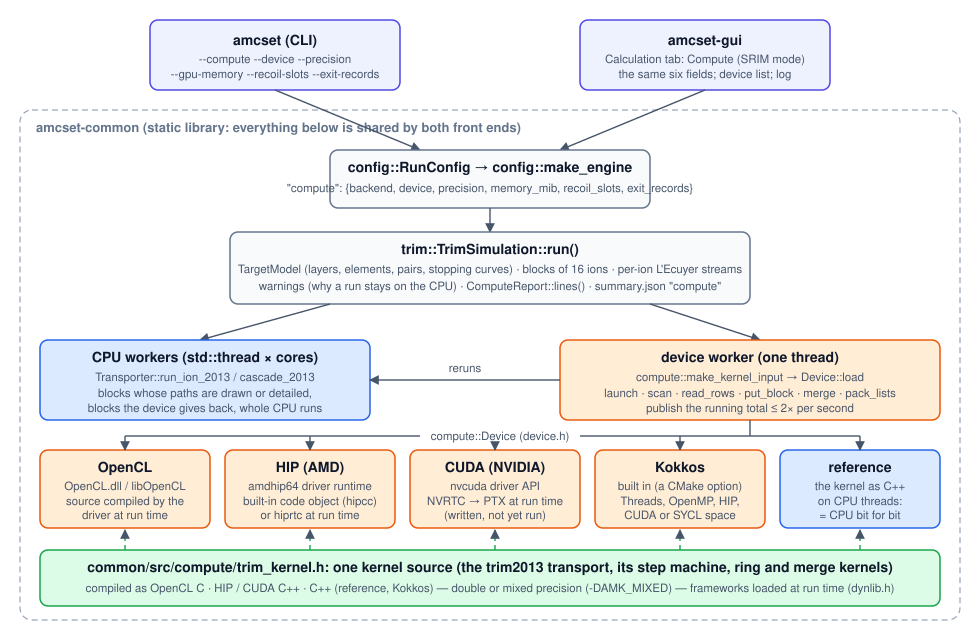

| Backend (`compute.backend`) | Framework | Kernel compiled | Runtime needed | Tested |
|---|---|---|---|---|
| `cpu` (default) | none: the CPU transport on all cores | with AMCSET | | yes |
| `opencl` | OpenCL 1.2 with `cl_khr_fp64` | at run time by the platform | the GPU driver's OpenCL (`OpenCL.dll`, `libOpenCL.so.1`) | AMD RX 7900 XTX |
| `hip` | AMD HIP (ROCm) | ahead of time with hipcc (built-in code object), or at run time with hiprtc | the AMD driver's HIP runtime (`amdhip64_7.dll`, `libamdhip64.so`); hiprtc only for a GPU the code object lacks | AMD RX 7900 XTX |
| `cuda` | NVIDIA CUDA (driver API) | at run time by NVRTC, to PTX | the NVIDIA driver (`nvcuda.dll`, `libcuda.so.1`) and NVRTC (CUDA toolkit) | **not yet** (no NVIDIA GPU here) |
| `kokkos` | Kokkos 4 | with AMCSET, for Kokkos's default execution space | Kokkos at build time (`-DAMCSET_WITH_KOKKOS=ON`) | Threads space |
| `reference` | none | with AMCSET, as C++ | | yes: reproduces `cpu` bit for bit |

Every framework is loaded at run time (`dynlib.h`), so one AMCSET build
runs on machines with any, all or none of them; AMCSET builds without any
GPU SDK (the few API functions and constants are declared in the backend
files from the vendors' public headers).

Contents: [Using it](#using-it) · [Which to choose](#which-to-choose) ·
[What the results are](#what-the-results-are) · [How a run works](#how-a-run-works) ·
[Precision](#precision) · [CPU against GPU](#cpu-against-gpu) · [Speed](#speed) ·
[Profile](#profile) · [Frameworks considered](#frameworks-considered) ·
[Building](#building) · [Changing the transport](#changing-the-transport) ·
[Figures](#figures)

## Using it

The same six settings in the scenario, the CLI and the GUI:

| Scenario key (`compute.`) | CLI | GUI (Calculation tab, *Compute (SRIM mode)*) | Default |
|---|---|---|---|
| `backend` | `--compute cpu\|opencl\|hip\|cuda\|kokkos\|reference` | Backend | `cpu` |
| `device` | `--device N` | Device | 0 |
| `precision` | `--precision double\|mixed` | Precision | `double` (`physics.fast_math` selects `mixed` on a GPU) |
| `memory_mib` | `--gpu-memory MIB` | Device memory | 0 = 2048 MiB |
| `recoil_slots` | `--recoil-slots N` | Recoil slots | 0 = from the most energetic possible recoil |
| `exit_records` | `--exit-records N` | Exit records | 0 = 256 per block of 16 ions |

```
amcset devices                                  # what the machine has (the GUI lists it under the settings)
amcset run scenario.json --compute hip --precision mixed
```

```json
"compute": {"backend": "hip", "device": 0, "precision": "mixed",
            "memory_mib": 0, "recoil_slots": 0, "exit_records": 0}
```

or `"compute": "opencl"`. A run the kernel does not cover, or one too small
to fill a GPU, gets a warning that says why (the CLI prints it, the GUI's
log shows it). A backend that cannot be opened (no driver, no such device,
AMCSET built without Kokkos) stops the run with the reason, for example
`OpenCL: no device 9 (1 found; amcset devices lists them)`; it does not
fall back to the CPU unasked. After a GPU run both front ends show the same report, from
`TrimSimulation::ComputeReport::lines()`, and `summary.json` records it
under `compute` (docs/OUTPUT.md). The CLI, for one million ions of 50 keV
Fe in Fe with quick damage:

```
SRIM mode results (1000000 ions, 0.7 s)
  Ran on HIP device 0: AMD Radeon RX 7900 XTX [built-in code object, mixed precision]: 62500 blocks of 16 ions; CPU 0 blocks
                       setup 0.2 s, device 0.5 s; 24576 lanes, a ring of 36864 blocks, recoil stack depth 0
                       kernel 0.4 s in 3 launches, 3 merges on the device; results to the host 0.000137 s, host side 0.0422 s
                       steps per block: mean 1338, max 1832; total 8.36e+07 (2.04e+08 per second)
  Projected range      186.0 A   straggling 92.1 A
  ...
```

The GUI, for 200,000 ions with full cascades (the Compute group, and the
log after the run; offscreen screenshots, `amcset-gui --screenshots`):

<p>
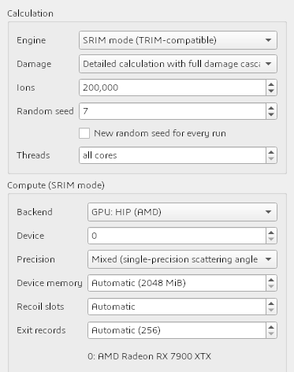
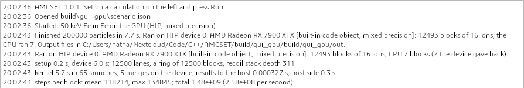
</p>


The GUI's plots and tables are the same as for a CPU run (they read the
same tallies); its live plots during the run come from the running total
the device publishes twice a second (see [How a run works](#how-a-run-works)):

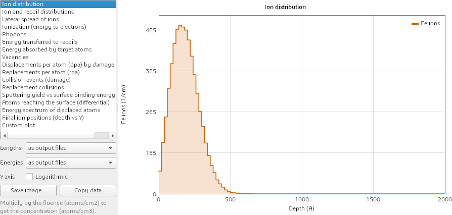

## Which to choose

On the workstation (Ryzen 7 7800X3D, RX 7900 XTX), for this use case:

- **AMD GPU: `hip` with `--precision mixed`.** It runs the same kernel
  twice as fast as OpenCL on the same GPU (5.7 s against 11.0 s of kernel
  time for 200,000 full cascades) and, with AMCSET's built-in code object,
  needs only the driver. 200,000 ions of 50 keV Fe in Fe with full
  cascades: 6.0 s against 26.0 s on the 16-thread CPU (4.3 times faster);
  one million ions with quick damage: 0.8 s against 3.7 s. `opencl` is the
  fallback that needs nothing else.
- **NVIDIA GPU: `cuda`**, or `opencl` (CUDA has not been run yet).
- **Intel GPU: `opencl`** (or Kokkos built for SYCL).
- **The CPU for small runs, heavy ions and double precision on consumer
  GPUs.** The 16 ions of a block run in order, so a run of N ions has N/16
  independent work items, and a GPU needs some 10⁴ of them
  ([Speed](#speed)): below about 10⁵ ions the CPU is faster (2,000 ions of
  1 MeV Fe: 2.7 s on the CPU, 37 s on HIP). AMCSET says so in a warning.
  Runs of long cascades usually have few ions, and so few blocks
  (16,000 ions of 200 keV Au in Si are 1,000 blocks: CPU 8.6 s, HIP
  13.7 s).
  A consumer GPU runs double precision at 1/32 (AMD RDNA3) to 1/64
  (NVIDIA) of its single-precision rate, so `double` there is no faster
  than the CPU (HIP: 27.6 s for the 200,000 full cascades); data-centre
  GPUs (AMD Instinct, NVIDIA A100/H100) run it at half rate, where
  `double` should do far better than here (not measured).
- **SYCL and Vulkan** are not separate backends; see
  [Frameworks considered](#frameworks-considered).

## What the results are

- **Same algorithm, not the same numbers.** The kernel reproduces the CPU
  transport expression by expression, in the same order of random draws
  (SI quantities, the same conversions). Compiled as C++ (`reference`, or
  Kokkos on a CPU space) it gives the CPU's tallies bit for bit
  (`ComputeKernel.*`: ten tests, every tally, moment, spectrum, position,
  exit and EXYZ record). On a GPU, exp, log, pow, sin and cos of the
  vendor's library differ from the C library's in the last bit (979 of
  1024 test values were identical on the RX 7900 XTX, the largest
  difference 3e-16), so individual histories part after a while: the
  results agree with the CPU's statistically ([CPU against
  GPU](#cpu-against-gpu)), and a GPU run is reproducible on the same
  device and driver.
- **The same blocks and the same sums.** Ions run in blocks of 16 with
  what TRIM keeps between ions (its recoil slots), as on the CPU. The
  blocks' tallies are added to the run's totals in block order, on the
  device, element by element: the CPU's order of additions. A run of N
  ions is therefore exactly the first N ions of a longer run with the same
  seed, on the CPU and on a device.
- **What runs on the CPU.** A whole run, with a warning that says why, if
  the kernel does not cover it. These stay on the CPU by decision, since a
  GPU version would cost more than it gains:
  - the **crystal transport**: its collision partners come from a search
    of the lattice around the path (neighbour cells, thermal displacements,
    polycrystal grains), a large data-dependent working set per step that
    does not suit lanes stepping in lockstep, and it would be a second
    transport in the kernel;
  - the **refined transport**: it is kept for comparison with the trim2013
    transport, not for production runs;
  - **MD events**: they hand a modest number of cascades to molecular
    dynamics, where the MD run, not the BCA, takes the time;
  - **trajectories of every ion** and EXYZ.txt with more than 256 records
    per ion: writing them, not the transport, takes the time.

  Single blocks: the ions whose paths the GUI draws (`trajectory_ions`) or
  COLLISON.txt details, and blocks the device gives back because their
  recoil stack or exit list outgrew its buffer (rerun on the CPU and put
  back in their place; the report counts them: "the device gave back").

## How a run works

A GPU wants tens of thousands of threads doing the same thing; a BCA
history is a long, branchy loop with a recoil stack of data-dependent
depth. Four choices make it fit.

### 1. The run, step by step

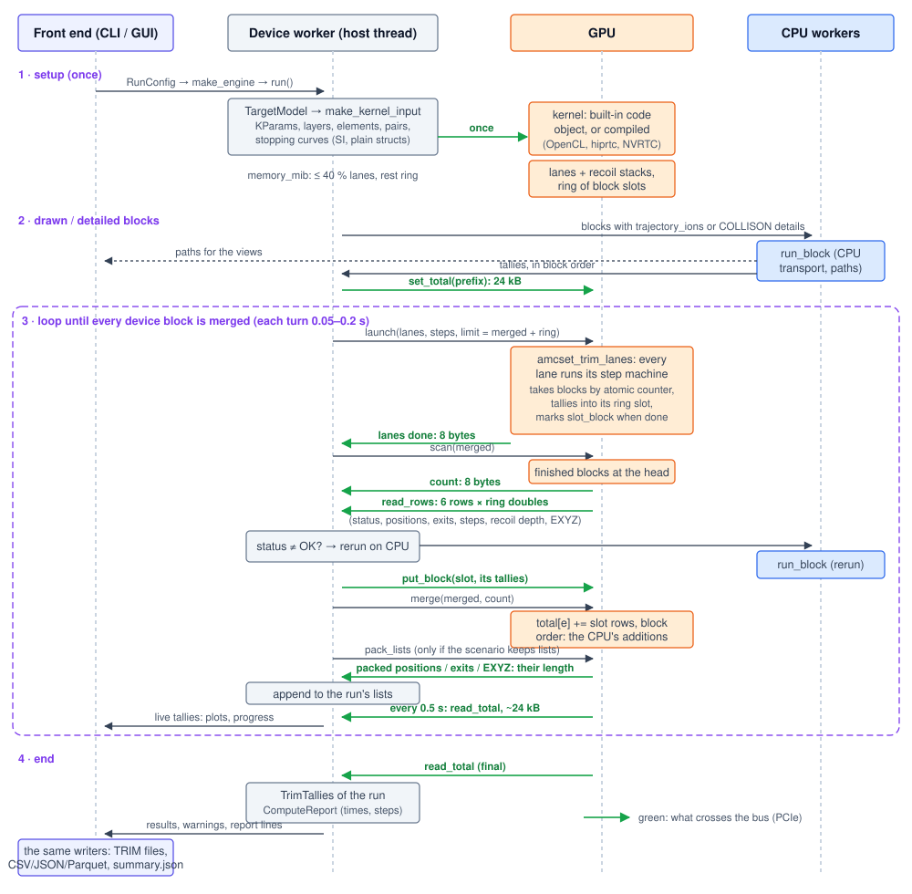

`TrimSimulation::run` builds the `TargetModel` as for a CPU run;
`compute::make_kernel_input` turns it into plain structs in SI units
(`KParams`, layers, elements, collision pairs, stopping curves), which go
to the device once. The blocks the CPU must run (drawn or detailed paths)
come first, and the device's running total starts from their sum. Then the
device worker loops: launch the lanes, find the finished blocks at the
head of the ring, rerun on the CPU any block the device gave back and put
its tallies in its slot, merge the finished blocks into the total on the
device, and copy their packed position and exit lists if the scenario
keeps them. Green arrows in the figure are everything that crosses the
bus. For 200,000 full cascades on HIP the run took 6.0 s: 5.7 s in the
kernel, 0.18 s setup, 0.0002 s copying totals to the host and 0.03 s of
host work in 65 launches.

### 2. A step machine per lane

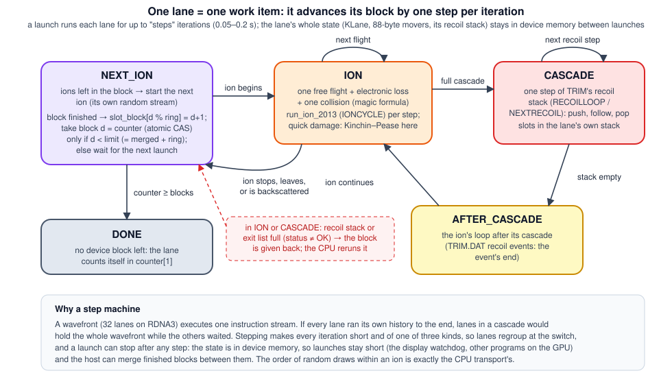

A *lane* (work item) advances its block by one step per iteration: one
flight and collision of the ion, or one step of the recoil stack
(`amk_step`). Lanes in a wavefront therefore do the same kind of work at a
time instead of each running its own cascade to the end, and a launch can
stop after any step: the lanes' state stays in device memory between
launches, which last 0.05 to 0.2 s. No launch nears Windows' display
watchdog (TDR, 2 s), and other programs that share the GPU wait at most
that long.

### 3. A ring of block slots, merged on the device

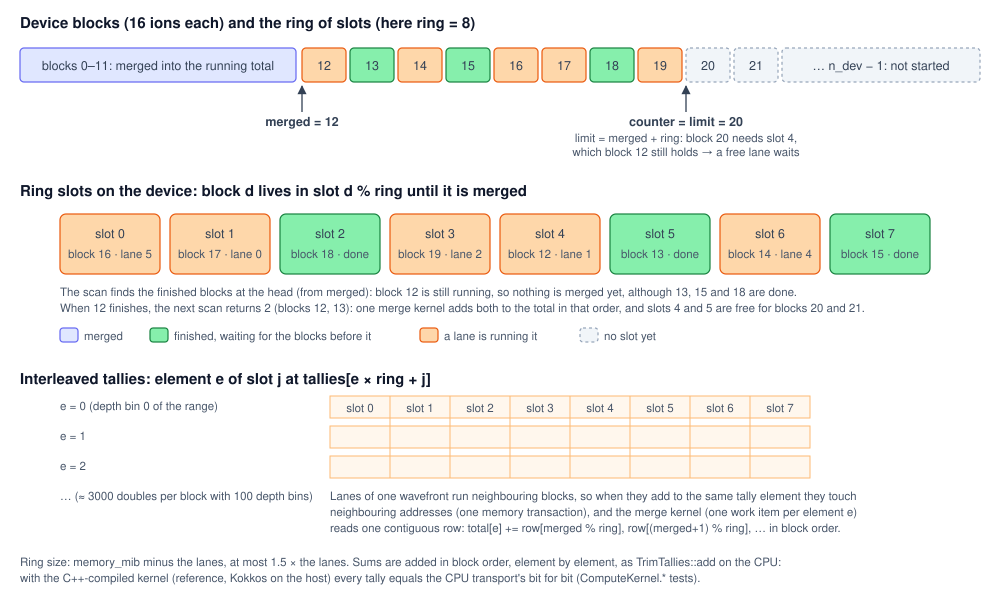

A lane that finishes a block marks its slot and takes the next block from
an atomic counter, if that block's slot is free. Between launches a scan
finds the finished blocks at the head of the ring, a merge kernel adds
them to the running total in block order, and their slots are free again.
The device streams through the run without batches: no lane waits for a
batch's slowest block, and the live plots see every merged block. The
first design ran batches of blocks; a batch lasts as long as its slowest
block, and the last, small batch nearly as long as the first:

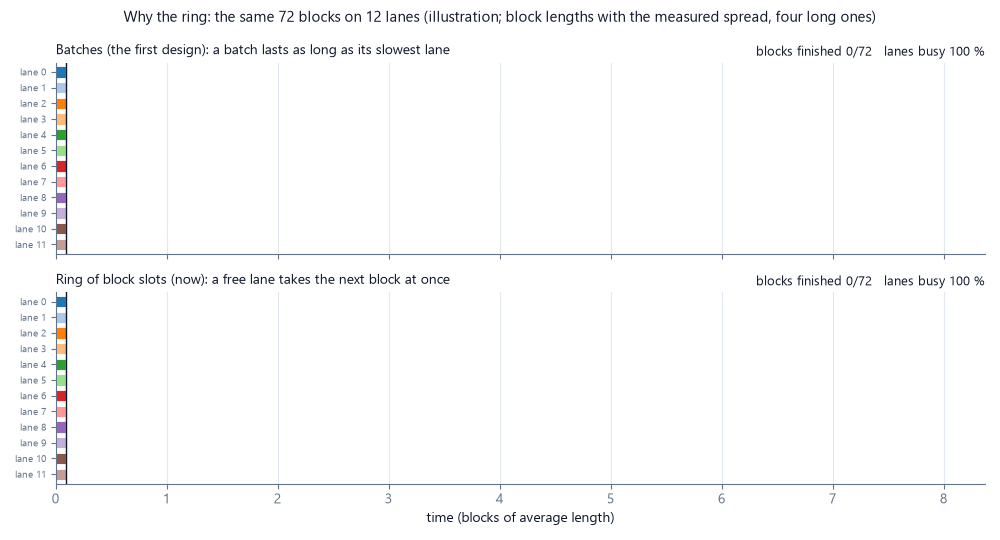

### 4. Interleaved tallies

Element e of slot j lies at `e × ring + j`, so that lanes of a wavefront,
which run neighbouring blocks, update neighbouring addresses, and the
merge kernel (one work item per element) reads one contiguous row.

### What reaches the host, and the live plots

Per launch the host reads a few numbers (lanes done, finished blocks),
six numbers per merged block (status, positions, exits, steps, recoil
depth, EXYZ records), and the merged blocks' lists, packed on the device
to their length. The running total (about 24 kB with 100 depth bins)
comes to the host at most twice a second for the live plots, and at the
end. Because blocks merge in order, what the live plots show after N ions
is exactly the result of an N-ion run with the same seed; the animation
below is made of such runs on the RX 7900 XTX:

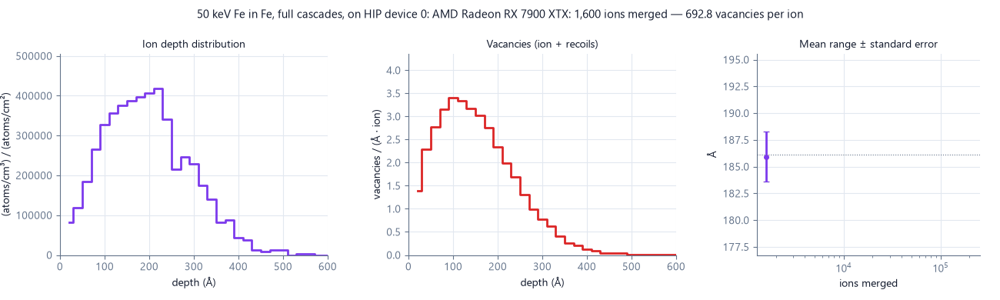

### Memory

`compute.memory_mib` (default 2048 MiB): up to 40 % for the lanes (each
has its own recoil stack), the rest for the ring (about 24 kB of tallies
per slot with 100 depth bins, 20 kB more with exit lists), at most 1.5
slots per lane. TRIM's recoil stack gains a slot with every collision of
the atom on top, so it gets deep: 73, 196, 593 and 1778 slots for Fe in
Fe at 10 keV, 50 keV, 200 keV and 1 MeV (400 ions each).
`compute.recoil_slots = 0` sizes it from the CSDA path of the most
energetic possible recoil (twice its monolayer steps plus 64). Exit lists
take 256 records per block (`compute.exit_records`); a shared pool would
use less memory, but which blocks overflow it would depend on the lanes'
timing, and with it which blocks the CPU reruns.

## Precision

`compute.precision`: `double` (default) runs the CPU's arithmetic.
`mixed` evaluates in single precision the iteration of the magic formula
for the closest approach, its fit constants, the stopping-power
interpolation, the rotations of directions, the azimuth, the collision
kinematics, the square roots of impact parameters and straggling and the
power functions, and converts units by multiplying with reciprocals;
positions, energies, the energy transfer and every tally stay in double.
Consumer GPUs run single precision 16 to 64 times faster than double (32
times on the RX 7900 XTX: a microbenchmark of exp/log/pow/sqrt gave
2.2e9 iterations/s in double and 6.4e10 in float).

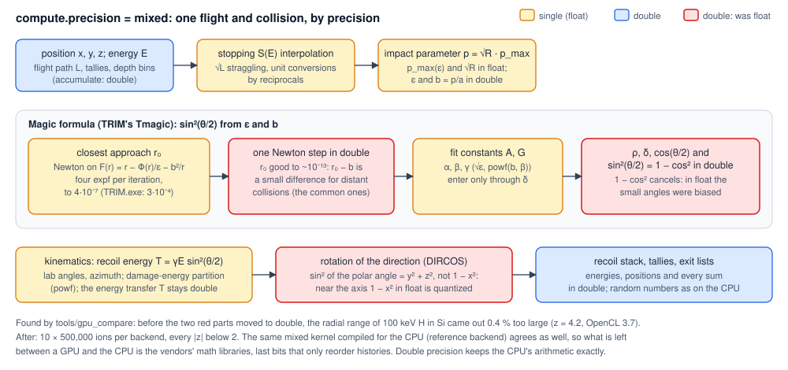

Two parts stay in double because single precision biased the results
(found by the comparison below): sin²(θ/2) = 1 − cos²(θ/2), which cancels
for the distant, small-angle collisions that are most of them, needs the
closest approach r₀ − b in double (the single-precision root, good to
4e-7, gets one Newton step in double), and a rotation needs
sin² of the polar angle as y² + z², not 1 − x², for directions near the
axis. In single precision those made the radial range of 100 keV H in Si
0.4 % too large (z = 4.2 on HIP, 3.7 on OpenCL). The fix costs speed
(OpenCL mixed went from 8.1 s to 12.8 s for the 200,000 full cascades;
both measured while the GPU ran other work).
`ComputeKernel.MixedPrecisionAgreesWithinStatistics` and
`tools/gpu_compare` check mixed precision against the CPU; a comparison
with the TRIM reference runs (`tools/trim_compare`) has not been made yet.

## CPU against GPU

`tools/gpu_compare/compare_backends.py` runs seven cases (Fe in Fe at
50 keV with full cascades and quick damage and at 1 MeV, Ar on SiO2 on Si
at 7°, H in Si, Au in Si, 2 keV Ar on Cu with monolayer steps) on the CPU
and on GPU backends, six runs of each with independent seeds, and gives
z = (mean_GPU − mean_CPU)/(combined standard error) for every quantity of
summary.json (range moments, backscattering, transmission, damage per
ion, energy partition, damage models, per-element yields; quantities that
are constant in every run, such as zero transmission, are left out).

**How to read z.** With six runs on each side the standard errors are
themselves estimates, so z follows Student's t with 10 degrees of freedom,
not a normal distribution: rms 1.12, 7.3 % beyond |z| = 2 and 1.3 % beyond
3 (normal: 4.6 % and 0.27 %). The quantities of a case share their runs
(vacancies, displacements, damage energy and NRT dpa move together), and
every backend is compared with the same six CPU runs, so deviations come
in correlated groups. A group that stands out is checked again with more
and larger runs before it is called real.

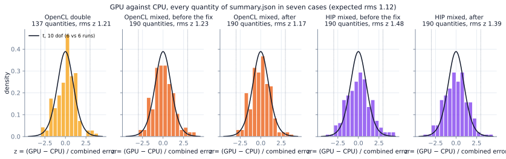

| Comparison (six runs of seven cases) | Quantities | rms z (1.12 expected) | Beyond \|z\| = 2 (7.3 % expected) | Beyond 3 (expected) |
|---|---|---|---|---|
| OpenCL double (five cases) | 137 | 1.21 | 7.3 % | 3 (1.8) |
| OpenCL mixed, before the fix | 190 | 1.23 | 8.9 % | 4 (2.5) |
| HIP mixed, before the fix | 190 | 1.48 | 15.8 % | 8 (2.5) |
| OpenCL mixed | 190 | 1.17 | 6.8 % | 3 (2.5) |
| HIP mixed | 190 | 1.39 | 13.2 % | 5 (2.5) |

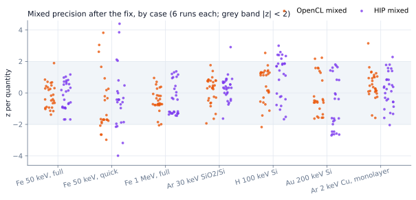

The groups that stood out after the fix, checked with more ions:

- **Fe 50 keV, quick damage** (ionization by recoils z = 3.8 on OpenCL,
  4.4 on HIP, the same in double precision): the six CPU runs happened to
  be low. With 10 runs of 1,000,000 ions per backend: CPU 21.3009 ±
  0.0006 %, OpenCL double 21.3005 ± 0.0008 %, OpenCL mixed 21.3005 ±
  0.0008 %, HIP mixed 21.3007 ± 0.0011 %; every quantity within
  |z| = 2.2.
- **H 100 keV in Si** (HIP rms 1.6): with 10 runs of 500,000 ions per
  backend, every |z| below 2 for OpenCL (rms 0.74) and HIP (rms 0.90).
- **Au 200 keV in Si** (HIP rms 1.7, damage group at z ≈ −2.6): with 10
  runs of 16,000 ions, HIP mixed rms 0.72, nothing beyond 2. The same mixed
  kernel compiled for the CPU (`reference`) agrees as well (rms 0.72) and,
  with the same seeds, gives nearly the HIP numbers: the GPU's math
  library does not shift the results.

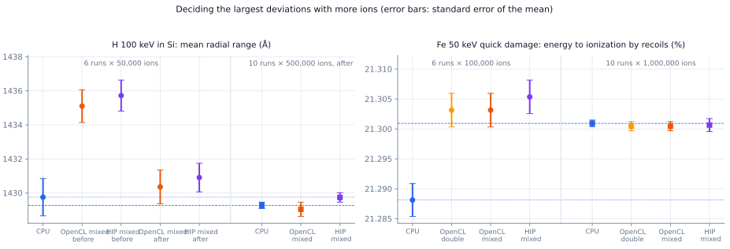

So: in double precision (OpenCL; HIP double was not compared) the GPU
agrees with the CPU within the statistics; in mixed precision, after the
fix, OpenCL and HIP agree too, in every case checked with large runs. HIP's six-run comparison scatters more than expected (rms 1.39);
every group behind that agreed when rerun with ten times the ions.

## Speed

`tools/gpu_compare/speed.py` runs each case once per backend and records
the wall time of `amcset run` and its compute report. Measured on the
workstation while the GPU ran other work: indications, not a benchmark.

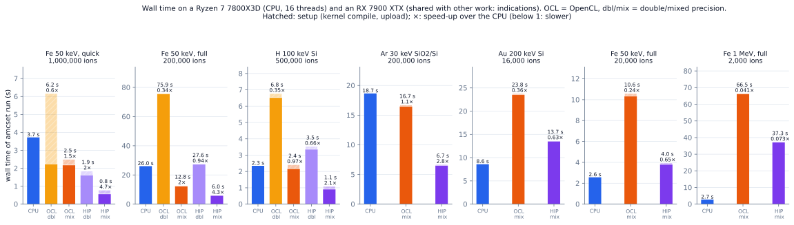

| Run (wall time, s) | CPU (16 threads) | OpenCL double | OpenCL mixed | HIP double | HIP mixed |
|---|---|---|---|---|---|
| Fe 50 keV in Fe, quick damage, 1,000,000 ions | 3.7 | 6.2 (3.9 compiling) | 2.5 | 1.9 | **0.8** |
| Fe 50 keV in Fe, full cascades, 200,000 ions | 26.0 | 75.9 | 12.8 | 27.6 | **6.0** |
| H 100 keV in Si, full, 500,000 ions | 2.3 | 6.8 | 2.4 | 3.5 | **1.1** |
| Ar 30 keV in SiO2/Si, full, 200,000 ions | 18.7 | | 16.7 | | **6.7** |
| Au 200 keV in Si, full, 16,000 ions | **8.6** | | 23.8 | | 13.7 |
| Fe 50 keV in Fe, full, 20,000 ions | **2.6** | | 10.6 | | 4.0 |
| Fe 1 MeV in Fe, full, 2,000 ions | **2.7** | | 66.5 | | 37.3 |

OpenCL compiles the kernel at run time; the driver caches the binary, so
only the first run after a change pays for it (3.9 s for double precision
above). HIP uses the code object built in with AMCSET.

**Why small runs are slow on a GPU.** One lane runs one block of 16 ions.
A run of 2,000 ions has 125 blocks, so 125 lanes work on a GPU built for
tens of thousands, and each lane is far slower than a CPU core. The
kernel's steps per second follow the lanes in flight:

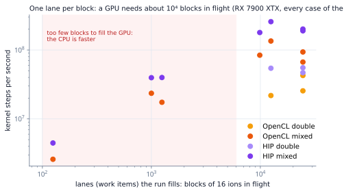

HIP mixed made 2.6 × 10⁸ steps per second with 12,500 lanes, 4 × 10⁷ with
1,000 and 4.5 × 10⁶ with 125. Splitting a block further would change the
results: the 16 ions of a block share TRIM's recoil slots in order, which
SRIM mode reproduces.

## Profile

How the kernel's time was found (RX 7900 XTX, 50 keV Fe in Fe, full
cascades, mixed precision; the GPU was running other work, so repeat
measurements varied by up to 20 %):

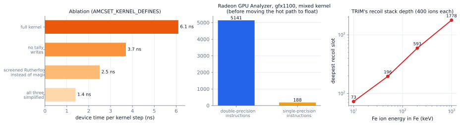

- **The report** (`amcset run`, the GUI's log, `summary.json`): setup,
  kernel, transfers and host time, launches and merges, kernel steps per
  block and per second. Before the ring, the kernel took 18.1 s of 18.5 s
  with exit lists on: transfers (0.0 s) and the host merge (0.3 s) were
  never the bottleneck, the batches were (a batch lasts as long as its
  slowest block). Blocks are even: 118,000 steps on average, 135,000 at
  most.
- **Ablation** (`AMCSET_KERNEL_DEFINES`, developers only, OpenCL): device
  time per step 6.1 ns; without tally writes 3.7 ns; screened Rutherford
  instead of the magic formula 2.5 ns; all three simplified 1.4 ns.
- **Static analysis** with AMD's Radeon GPU Analyzer (`rga -s opencl -c
  gfx1100 -D AMK_MIXED --isa --livereg -a`): wave32, 196 VGPRs (7 waves per
  SIMD), 122 kB of code, and 5141 double-precision against 188
  single-precision instructions even in mixed precision: 118 double
  divisions (unit conversions), double square roots and the library
  expansions of double sin, cos, exp and pow. Moving those of the hot
  path to single precision took the kernel from 11.8 s to 8.1 s.
- **Radeon GPU Profiler** (Radeon Developer Tool Suite 2026-10-02):
  `RadeonDeveloperPanelCLI -m profiling -p amcset
  --rgp-auto-capture=dispatch:20:1 --rgp-instruction-tracing -o out.rgp`
  captures a dispatch with instruction timing (with `AMCSET_GPU_STEPS=100`
  to keep dispatches short; long ones fail with result -2). Reading the
  capture needs the RGP window; that analysis is still to do.

## Frameworks considered

- **OpenCL, HIP, CUDA, Kokkos**: built (above). HIP is the fastest here:
  the same kernel source runs about twice as fast as through OpenCL on the
  same GPU (measured; the cause has not been analysed), and with its
  built-in code object it has no compile step at run time.
- **SYCL** is single-source C++ like Kokkos. Its implementations reach
  AMD and NVIDIA GPUs only on Linux (Intel's oneAPI with Codeplay's
  plugins, AdaptiveCpp); on Windows, oneAPI targets Intel GPUs. Kokkos
  has a SYCL execution space, so AMCSET's Kokkos backend reaches SYCL
  devices without a backend of its own, and OpenCL covers Intel GPUs
  directly. Not tested here (no SYCL implementation for this GPU on
  Windows).
- **Vulkan compute** would need the transport in GLSL or HLSL (a third
  copy of it), and SPIR-V for Vulkan has no double-precision exp, log,
  pow, sin or cos (GLSL.std.450 defines them for 16- and 32-bit floats
  only): the double kernel, which reproduces the CPU's arithmetic, cannot
  be written without a software math library, and clspv (OpenCL C to
  Vulkan) inherits the same limit. It reaches the same hardware as OpenCL,
  HIP and CUDA, which have double precision. Not built.

## Building

- OpenCL, CUDA, `reference`: nothing to do.
- HIP's built-in code object: configure with `-DAMCSET_HIPCC=<hipcc>` or
  set the environment variable `AMCSET_HIPCC` when configuring (for
  example the hipcc of AMD's ROCm Python packages, `pip install
  --index-url https://stable.repo.amd.com/rocm/whl-next/ "rocm[devel]"`,
  which leaves the display driver alone). The path is kept in the CMake
  cache, and the configure log says `HIP code object: compiled with ...`
  or `none`. `AMCSET_HIP_ARCHITECTURES` lists the GPUs (default gfx1100,
  gfx1101, gfx1102, gfx1030, gfx1200, gfx1201, gfx90a, gfx942; about
  1.9 MB for double and 1.7 MB for mixed precision). Without it, HIP
  compiles the kernel with hiprtc on first use: the HIP SDK's
  `hiprtc*.dll` / `libhiprtc.so` is found through `HIP_PATH`, `ROCM_PATH`,
  `C:\Program Files\AMD\ROCm\*\bin`, `/opt/rocm/lib`, or named in
  `AMCSET_HIPRTC`.
- CUDA: NVRTC from the CUDA toolkit, found through `CUDA_PATH` or
  `/usr/local/cuda/lib64`, or named in `AMCSET_NVRTC`.
- Kokkos: build Kokkos 4 (any execution space; for a GPU space with its
  compiler wrapper), then configure AMCSET with `-DAMCSET_WITH_KOKKOS=ON
  -DKokkos_DIR=<install>/lib/cmake/Kokkos`. Kokkos runs on a thread of its
  own (some execution spaces take work only from the thread that started
  them).

## Changing the transport

The kernel duplicates the trim2013 transport on purpose (the CPU transport
also records trajectories, MD events and COLLISON.txt details, which the
kernel leaves out). `ComputeKernel.MatchesTheCpuTransport*` compares every
tally bit for bit in ten tests, so a change to
`trim_engine.cpp`'s trim2013 functions fails those tests until the same
change is made in `trim_kernel.h`. The kernel's rules: C99/C++ common
subset (no references, templates, standard headers in device code), only
8-byte members in structs shared with the host (`static_assert`s in
`kernel_input.cpp`), the same expressions in the same order as the CPU,
SI units with the same conversions (`AMK_A`, `AMK_EV`: divisions in double
precision, reciprocals in mixed). Test with `common-test
--gtest_filter=Compute*`, on a GPU with `AMCSET_TEST_GPU=opencl` (or
`hip`, `cuda`, `kokkos`) for `ComputeGpu.AgreesWithTheCpu`, and against
the CPU over many seeds with `tools/gpu_compare` (a change to mixed
precision: also the larger checks above, ten runs of 10⁵–10⁶ ions).

## Figures

The diagrams (`docs/gpu/figures/*.svg` drawn by hand: architecture,
run_workflow, step_machine, ring, precision) describe the code; keep them
in step with it. The plots and animations are drawn from data by
`tools/gpu_compare/make_figures.py` (needs matplotlib and numpy) after:

```
python tools/gpu_compare/compare_backends.py --amcset build/Release/amcset.exe --backends opencl:double --runs 6 --out build/gpu_compare/double
python tools/gpu_compare/compare_backends.py --amcset build/Release/amcset.exe --backends opencl:mixed,hip:mixed --runs 6 --out build/gpu_compare/mixed3
python tools/gpu_compare/speed.py --amcset build/Release/amcset.exe --out build/gpu_compare/speed
python tools/gpu_compare/speed.py --amcset build/Release/amcset.exe --live hip:mixed --out build/gpu_compare/live
python tools/gpu_compare/make_figures.py
```

(`mixed/` holds the comparison before the precision fix; `more/` and
`refcheck/` the larger checks; the script draws what it finds.) The GUI
screenshots come from `amcset-gui --screenshots DIR --quit` with
`QT_QPA_PLATFORM=offscreen` (docs/GUI.md) on a scenario with
`"compute": {"backend": "hip", "precision": "mixed"}`.
