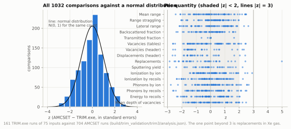
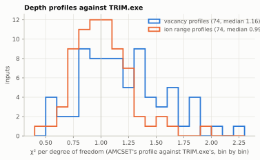
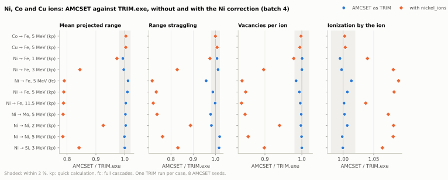
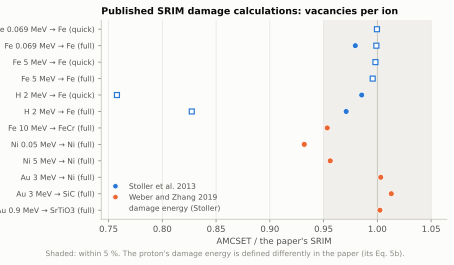

# 1. AMCSET against TRIM.exe

[Review contents](README.md) · next: [2. Electronic stopping](02-stopping.md)

AMCSET's SRIM mode re-implements the transport of SRIM-2013's TRIM.exe, as
recovered by disassembling it (`docs/TRIM2013_ALGORITHM.md`), bugs included.
This is the foundation of every other chapter: if AMCSET reproduces TRIM.exe,
then the comparisons with measurements test SRIM-2013's physics, and their
deviations are SRIM's. This chapter shows how closely it does, and how a
reproduction is judged when both codes are Monte Carlo.

## 1.1 The method: compare distributions, not single runs

Two Monte Carlo codes that do the same thing still differ run by run. The
test is therefore statistical. Each TRIM.exe input was run once or several
times by TRIM itself, and 8-12 times by AMCSET with different seeds. For each
quantity the difference of the means is divided by its standard error (from
the scatter of both codes' runs) and turned into a normal deviate z.
If AMCSET does what TRIM does, the z values of many quantities follow a
standard normal distribution: about 95 % within ±2, nearly all within ±3. A
real difference shows up as a z beyond 3 that persists with more seeds and
in related inputs.

The reference set (`tools/srim/`, results in `<SRIM>\_amcset\results\trim3`):
75 distinct inputs and 161 TRIM.exe runs, covering H, He, N, O, Si, Ar, Fe,
Ni, Xe and Au ions from 1 keV to 50 MeV and PKAs started inside the target
(TRIM.DAT); elements, alloys, oxides, layered targets, gases, thin foils;
quick (Kinchin-Pease) and full-cascade damage; sputtering, oblique
incidence, backscattering and transmission. AMCSET ran 704 times against them
(`tools\windows\compare_with_trim.bat`).

## 1.2 Integral quantities

*Figure 1.1. Left: the z values of all 1032 comparisons of integral
quantities, with the standard normal distribution for the same count.
Right: the same values by quantity.*

The histogram is the normal curve: 1031 of the 1032 comparisons lie within
|z| < 3. The one beyond is the replacements per ion in Xe gas, 4.6 % above
TRIM's at z = 5.0. It is the only open difference. The leading suspect is
TRIM's single-precision bookkeeping of recoil slots, which AMCSET does not
reproduce bit for bit (`docs/VALIDATION.md` §2.2).

No quantity leans: ranges, straggling, lateral spread, backscattering,
vacancies, replacements, sputtering, and the five-way energy partition
(ionization and phonons of ion and recoils, energy to recoils) are centred on
zero. This matters because a model difference usually moves several
correlated quantities the same way (for instance energy moving from recoils
to ionization). The first rounds of this comparison found such patterns and
traced each to a difference from TRIM.exe, fixed since (`docs/VALIDATION.md`
§2.1).

## 1.3 Depth profiles

*Figure 1.2. χ² per degree of freedom of AMCSET's vacancy and ion-range
profiles against TRIM's, bin by bin, for every input.*

Integral quantities could agree while profiles differ in shape. Each
profile is compared bin by bin with a χ² that includes the scatter of both
codes. A χ²/ndf near 1 means the profiles are the same within the
statistics. The medians are 1.17 for vacancy profiles and 0.99 for ion-range
profiles over 74 inputs; the largest are 2.21 and 2.00, both for 10 keV Fe in
Fe, whose shallow profiles have few bins. Vacancy profiles sit slightly
above 1 because TRIM's vacancy tallies are correlated between bins (one
cascade fills several), which the χ² treats as independent.

## 1.4 Ni, Co and Cu ions (batch 4)

Chapter 3 shows that SRIM-2013's stopping of Ni ions is out of line, and
AMCSET offers a correction. Eleven more TRIM.exe runs check two things: that
AMCSET reproduces TRIM for Ni ions without the correction, and how much the
correction changes.

*Figure 1.3. Ni ions into Fe (1-11.5 MeV), Mo, Ni and Si, and Co and Cu into
Fe at 5 MeV as controls: AMCSET over TRIM.exe, as TRIM (blue) and with the
correction (orange).*

As TRIM, AMCSET agrees: 166 of 169 quantities and 21 of 22 profiles lie
within 3σ. The exceptions belong to one run, 5 MeV Ni into Fe (quick), and
are one effect seen four ways: ionization by the ion +0.70 % (z 3.4), by the
recoils −2.6 %, energy to recoils −1.4 %, and the vacancy profile. The same
case shows the largest range excess (+0.9 %, z 2.8). Whether this ~1 % lean
at 5 MeV is real or a fluctuation of the single TRIM run per case is open;
more TRIM seeds would settle it. It is a twentieth of the correction's
effect.

With the correction, Ni ranges shrink by 21 % at 5-11.5 MeV, by 7-16 % at
2-3 MeV and by 3 % at 1 MeV. The straggling shrinks more than the range, the
vacancies per ion fall by about 15 % (more energy goes to ionization), and
Co and Cu are untouched. So TRIM.exe itself produces the long Ni ranges that
the measurements of Chapter 3 contradict.

## 1.5 Published SRIM calculations

A different check: other users' SRIM runs, reproduced from what their papers
state.

*Figure 1.4. Vacancies per ion (dots) and damage energy (squares) of AMCSET
over the published values. Stoller et al., Nucl. Instrum. Methods B 310, 75
(2013), Table 4 with its 2019 erratum (SRIM-2008, Fe, Ed 40 eV); Weber and
Zhang, Curr. Opin. Solid State Mater. Sci. 23, 100757 (2019), Table 1
(full cascades).*

Stoller et al.'s heavy-ion cases agree to 0-2 % in vacancies and damage
energy, quick and full cascades alike. Their proton damage energy is a
different quantity: the erratum's Eq. 5b counts more than the energy not lost
to ionization; the vacancies still agree (0.97-0.99). Weber and Zhang state
neither their SRIM version nor their ion count nor Es. Their self-ion cases
(Fe in Fe-10Cr, Ni in Ni) lie 4-7 % above AMCSET's, and their Au cases within
1.3 %. This is consistent with an older SRIM version or other binding
energies, and does not point to a difference in AMCSET's transport, which
§1.2 tests directly.

## 1.6 What this chapter establishes

AMCSET's SRIM mode is a faithful, statistically indistinguishable
reproduction of SRIM-2013's TRIM.exe over the 75 inputs tested, with one
open difference (replacements in Xe gas). The remaining chapters can
therefore treat AMCSET's results as SRIM-2013's when they compare with
measurements.
