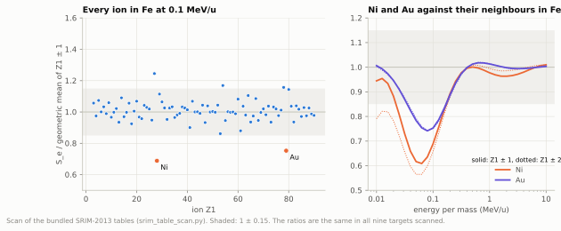
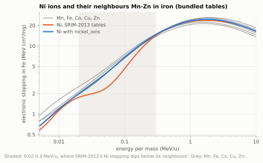
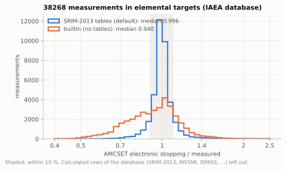
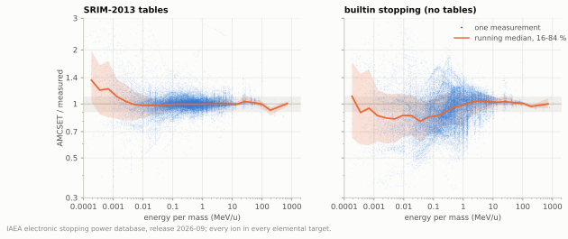
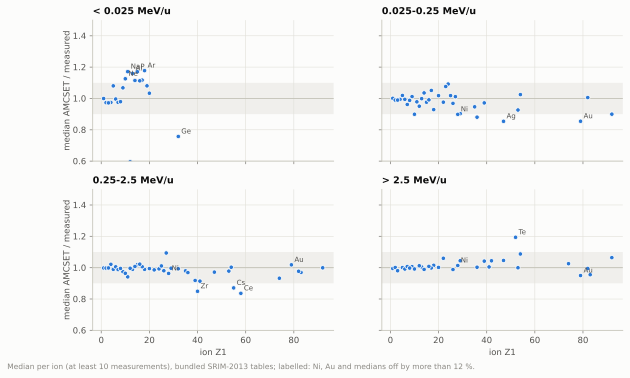
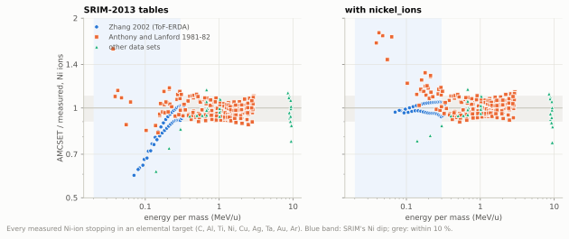
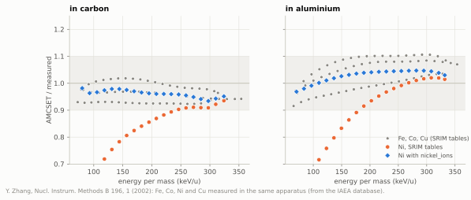
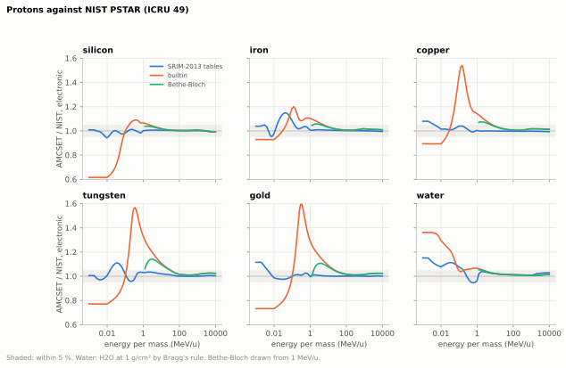
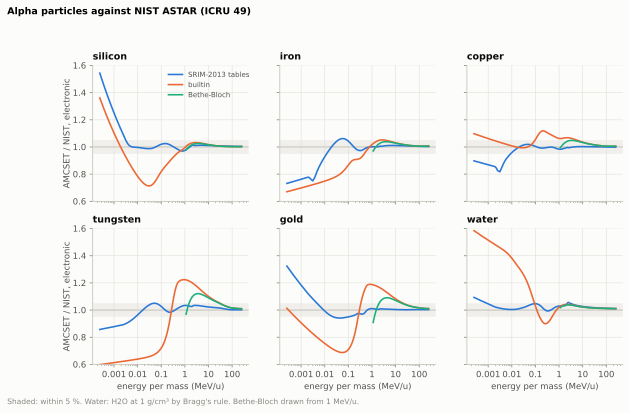
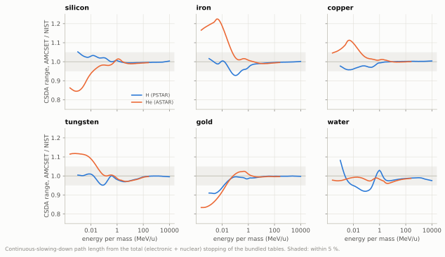

# 2. Electronic stopping

[Review contents](README.md) · previous: [1. AMCSET against TRIM.exe](01-trim.md) ·
next: [3. The Ni-ion problem](03-nickel.md)

Electronic stopping decides how deep an ion goes once it is faster than a
few keV per nucleon, and how its energy is shared between ionization and
damage. AMCSET's SRIM mode takes it from SRIM-2013's tables, extracted from
the SR Module for every ion (Z = 1-92) in every element and bundled with the
program (`data/srim2013`). This chapter asks three questions: are the
bundled tables SRIM-2013's; where are SRIM-2013's tables out of line with
themselves; and how do they compare with measurements and reference
tables?

## 2.1 The tables against their own trend

SRIM builds the stopping of heavy ions by scaling its proton stopping with
an effective charge that has ion-specific parameters. Stopping changes
smoothly with the ion's atomic number Z1, apart from Z1 oscillations at low
velocity. A scan of the tables (`srim_table_scan.py`) compares every ion's
stopping with the geometric mean of its neighbours' (Z1 ± 1, and separately
Z1 ± 2) at the same velocity, in nine targets.

*Figure 2.1. Left: every ion in Fe at 0.1 MeV/u, its stopping over that of
its two neighbours. Right: Ni and Au over the whole velocity range.*

Two ions stand out, by the same factor in every target: Ni, at 0.61-0.69 of
its neighbours near 0.06-0.1 MeV/u, and Au at 0.74-0.75. Because the ratio
is identical to three digits in C, Si, Fe, Ni, Cu, Mo, Ag, W and Au, the dip
lies in SRIM's ion-specific scaling, not in any target's data. The Ni dip
spans 0.02-0.3 MeV/u, which is 1-17 MeV for a Ni ion: exactly the range of
the Ni-ion irradiations used to emulate reactor damage.

*Figure 2.2. Electronic stopping of Mn-Zn ions in iron from the bundled
tables. SRIM-2013's Ni (orange) sags below its neighbours (grey) between
0.02 and 0.3 MeV/u; the correction of Chapter 3 (blue) follows them.*

## 2.2 The bundled tables are SRIM-2013's

The IAEA's electronic stopping power database (release 2026-09) contains,
besides measurements, a copy of SRIM-2013's tables: 120 304 values for 793
ion-element pairs. The bundled tables reproduce that copy with a median
ratio of 0.9998 and a median deviation of 0.16 %. A few whole pairs differ
by a constant factor at every energy: O, Si and Mg ions in gases by
11-17 %, Au ions by 5.9 % in every target, W in Fe by a factor of 270, and
C and B in Sn and Pb by 2-3. In each of these the bundled table runs
smoothly with the neighbouring targets, so the differences look like unit or
phase conversions in the database's copy. They were not traced further.

## 2.3 Against 38 268 measurements

After the calculated rows are removed (SRIM-2013's table, MSTAR, DPASS,
CasP, ESPNN, ICRU 49, TDDFT; 207 255 rows), the database holds 38 268
measurements of electronic stopping in elemental targets, for 901
ion-target pairs. AMCSET's stopping was interpolated at each measured
energy, once with the SRIM tables (the default) and once without them (the
`builtin` model, used when the tables are not available).

*Figure 2.3. Distribution of AMCSET over measured, all 38 268 measurements.*

With the tables the median ratio is 0.996; 81.3 % of the measurements lie
within 10 % and 93.9 % within 20 %. This agreement is partly circular: SRIM
was fitted to many of the same data, above all for H, He and Li ions, whose
medians are 0.97-1.00 in every velocity band. The `builtin` model is much
broader (median 0.940, 64.8 % within 20 %). It is adequate only above about
2.5 MeV/u, where it is a Bethe-type formula.

*Figure 2.4. AMCSET over measured against the ion's energy per nucleon,
every measurement (blue dots), with the running median and 16-84 % band
(orange).*

With the tables, the median is flat at 1 from about 0.005 to 100 MeV/u.
Below about 0.003 MeV/u it rises: SRIM's stopping of very slow ions is
higher than measured, with a spread of tens of per cent. These are the
energies of sputtering and of the end of every cascade, but there electronic
stopping is a small part of the energy loss. `builtin` is about 15 % low
below 0.25 MeV/u (band medians 0.859 and 0.852), the range of most
implantations.

*Figure 2.5. Median ratio per ion (at least 10 measurements) in four
velocity bands.*

Per ion, the medians stay within 10 % in most cases. Two patterns remain.
Below 0.025 MeV/u, the ions from Ne to Ar are 11-18 % high (except Mg,
0.60), and Ge is 24 % low. Between 0.025 and 0.25 MeV/u, heavy ions tend to be low: Kr 0.880,
Ag 0.854, Au 0.855, U 0.900, Ni 0.898, Cu 0.903. Ni's median is no further
off than its neighbours', but the median hides the data sets behind it
(§2.4).

## 2.4 The measured stopping of Ni ions

*Figure 2.6. Every measured Ni-ion stopping power in an elemental target,
by data set: left with SRIM-2013's tables, right with the correction of
Chapter 3. Blue band: SRIM's Ni dip.*

The measurements of Ni ions in the dip's band come mostly from two
sources, and they disagree:

- **Zhang 2002** (Nucl. Instrum. Methods B 196, 1; time-of-flight ERDA)
  measured Ni in C and Al. SRIM-2013 lies 15-18 % below these measurements
  (medians 0.815 and 0.848), deepest at the low velocities of the dip. With
  the correction they come to 0.966 and 1.029.
- **Anthony and Lanford 1981-82** measured Ni in Cu, Ag and other targets.
  Their data lie at or below SRIM-2013's Ni (Cu 1.138, Ag 0.970), and with
  the correction AMCSET's stopping is 16-30 % higher than theirs. SRIM's Ni
  tables may rest on these data.

*Figure 2.7. Zhang 2002 measured Fe, Co, Ni and Cu in the same apparatus.
Against SRIM-2013 the neighbours (grey) lie within 9 %; Ni (orange) falls
to 0.6-0.8 at its lowest energies. The correction (blue) puts Ni with its
neighbours.*

The one data set that measured Ni together with its neighbours shows that
Ni is the odd one out, by the amount of the dip. The measured stopping alone
cannot settle the question, because the two sources disagree. The measured
ranges in Chapter 3 can, and they side with the correction. No measurement
of Ni-ion stopping in Fe or Ni, the targets of the range measurements, is in
the database.

The same band hints at Au: Jokinen's ToF-ERDA data (1997) give 0.82 in Al,
0.93 in C and 0.74 in Cu at 57-187 keV/u, and Pb, three elements on, lies
within 8 % in eight targets. But measured Au ranges in light targets are
already longer than SRIM's (Chapter 4); raising Au's stopping would shorten
them further. No correction is offered for Au.

## 2.5 Protons and alpha particles against NIST

NIST's PSTAR and ASTAR tables (ICRU Report 49) are the reference for light
ions. AMCSET's three electronic stopping models were compared with them in
Si, Fe, Cu, W, Au and water at NIST's energies.

*Figure 2.8. Protons: AMCSET's electronic stopping over NIST's, for the SRIM
tables (blue), the built-in model (orange) and Bethe-Bloch (aqua, above
1 MeV).*

*Figure 2.9. The same for alpha particles, per nucleon.*

Above 0.1 MeV/u the medians of the SRIM tables lie within 3 % of NIST in
the elements; single energies reach 8.5 % (protons in Fe at 0.1-1 MeV).
Water, a compound by Bragg's rule here (SRIM's tables carry no phase or bond
correction), lies within 4 %. Below 0.1 MeV/u the two tables part by up to
12 % (protons in Fe), where ICRU 49 rests on fits of its own.

The built-in model is accurate only at high energy: 0.5-6 % high at 10-100
MeV, and up to 60 % off near the stopping maximum in W and Au. Bethe-Bloch,
which the program uses for relativistic ions, is 0.3-6 % high at 10-100 MeV
and up to 14 % high at 1-10 MeV in W, where shell corrections matter.

*Figure 2.10. Continuous-slowing-down path lengths of protons and alpha
particles from the SRIM tables, over NIST's.*

The CSDA ranges integrate the stopping and include nuclear stopping. They
lie within 4 % of NIST's above 1 MeV/u, and up to 18 % off below (alpha
particles in Fe at 0.01-0.1 MeV/u), where nuclear stopping and the low-energy
fits dominate.

## 2.6 Summary

- The bundled tables are SRIM-2013's (median deviation 0.16 % from the
  IAEA's copy).
- SRIM-2013 fits the measured electronic stopping to a median of 0.996, best
  between 0.01 and 100 MeV/u; slow ions (below 0.005 MeV/u) and heavy ions
  at 0.025-0.25 MeV/u are its weak spots.
- Ni ions are the one case where the tables contradict their own Z1 trend
  and a modern measurement of the neighbours. Chapter 3 tests the
  correction against measured ranges.
- Without the tables, the built-in stopping is good only above about
  2.5 MeV/u. The default (the tables) should be kept.
