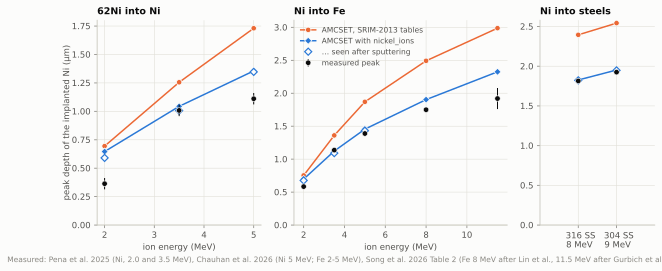
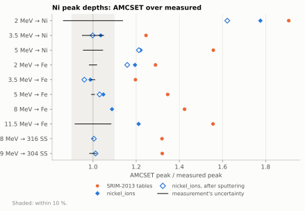
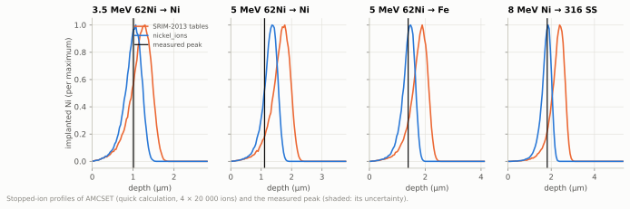
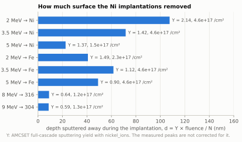

# 3. The Ni-ion problem

[Review contents](README.md) · previous: [2. Electronic stopping](02-stopping.md) ·
next: [4. Ranges](04-ranges.md)

Self-ion irradiation with Ni ions of a few MeV is a standard way to emulate
neutron damage in steels and nickel alloys, and SRIM is the standard way to
assign the dose: how many displacements per atom at which depth. Since 2025
several groups have measured where the implanted Ni actually stops, and
found it far shallower than SRIM-2013 predicts. This chapter reviews those
measurements, shows that AMCSET (like TRIM.exe) has the same error, and
tests the optional correction `physics.stopping_corrections.nickel_ions`.

## 3.1 The measurements

| Paper | What was measured | Method |
|---|---|---|
| Pena, Wang, Jiang, Chauhan, Garner, Nastasi, Shao, Nucl. Instrum. Methods B 565, 165738 (2025) | ⁶²Ni into pure Ni at 2.0 and 3.5 MeV, 4.6·10¹⁷ cm⁻² | ToF-SIMS: peaks at 364 and 1008 nm (their SRIM-2013: 720 and 1290 nm) |
| Chauhan et al., J. Nucl. Mater. 633, 157044 (2026), open access | ⁶²Ni into pure Ni and pure Fe at 2.0, 3.5 and 5.0 MeV, normal incidence, room temperature | ToF-SIMS, peak of a bi-Gaussian fit; at 5 MeV their SRIM peak is 625 nm (36 %) too deep in Ni and 501 nm (26 %) in Fe |
| Song, Was, Garner, J. Nucl. Mater. 633, 157002 (2026), Table 2 | the pure-Fe peaks of Chauhan et al.; 8 MeV ⁵⁸Ni in Fe and Fe-10Cr (Lin et al., EDX); 11.5 MeV in Fe (Gurbich et al. 2025, nuclear resonance profiling); 8 MeV into 316 and 9 MeV into 304 stainless steel | STEM-EDX of the Ni enrichment after high doses |
| Gurbich et al., Appl. Radiat. Isot. 215, 111590 (2025) (abstract) | 5 MeV Ni in Mo, 11.5 MeV Ni in Fe | resonance profiling; SRIM-2013 ranges 1.3 and 1.5 × too long |

The papers trace the problem to SRIM-2013's Ni electronic stopping:
TRIM-98, the predecessor, agrees much better; Co ions in SRIM-2013 behave as
Ni ions did in TRIM-98; and first-principles stopping (RT-TDDFT with the
projectile's semicore electrons, transported by molecular dynamics)
reproduces the measured Ni-in-Ni peaks (Chauhan et al.). Chapter 2 found
the cause in the tables: a dip of Ni's stopping to 0.61-0.69 of its
neighbours' at 0.02-0.3 MeV/u.

## 3.2 The correction

`nickel_ions` replaces the electronic stopping of Ni projectiles (and Ni
recoils) by the geometric mean of Co's and Cu's at the same velocity, from
SRIM-2013's own tables, in every target. It replaces only what is out of
line and leaves Ni as a target untouched. It was built from the table scan
and Gurbich et al.'s observation, before the measured peaks of this chapter
were available, so these peaks are a test of it, not its fit. It is off by
default, because SRIM mode reproduces TRIM.exe.

## 3.3 Peak depths

AMCSET ran each measurement as a quick calculation (Ed 40 eV, as the papers),
20 000 ions × 4 seeds, and took the peak of the stopped-ion profile.



*Figure 3.1. Measured peak depths (black) and AMCSET's, with SRIM-2013's
tables (orange) and with `nickel_ions` (blue); open diamonds: the corrected
peak as seen after the surface sputtered away during the implantation
(§3.5).*



*Figure 3.2. The same as ratios to the measured peak, with the measurements'
own uncertainties (black bars).*

**Without the correction**, AMCSET reproduces the papers' own SRIM-2013
peaks to −4 to +7 % (their SRIM bins were 40-50 nm wide), and is
1.2-1.9 × deeper than measured: SRIM-2013's error, carried by TRIM.exe and
by AMCSET alike.

**With the correction**, six of the ten peaks agree within 9 %: 3.5 MeV in
Ni and Fe, 5 MeV in Fe, 8 MeV in Fe, and both steels at 8 and 9 MeV. Three
of them agree within 2 % once sputtering is allowed for. The rest:

- 5 MeV into Ni and 11.5 MeV into Fe remain 21-22 % too deep. The 5 MeV Ni
  measurement had the lowest fluence and the noisiest profile of the series
  (its value here is SRIM's peak minus the 625 nm of the paper's text). The
  11.5 MeV value carries ±0.16 µm, so the difference is 2.5 σ.
- 2 MeV stays 1.2 × (Fe) and 1.8 × (Ni) too deep. A 2 MeV Ni ion
  (0.034 MeV/u) starts near the low edge of the dip and spends most of its
  path below it, so the correction changes it by only 7 %. Whatever shortens
  the measured 2 MeV peaks is not the dip.



*Figure 3.3. AMCSET's stopped-ion profiles with and without the correction,
and the measured peak.*

The correction narrows the profile more than it shifts it (the straggling
falls by about 25 %, Chapter 1). The measured profiles are only described
by their peaks in the papers, so the widths cannot be compared here.

## 3.4 TRIM-98 for comparison

Song et al. list TRIM-98's peaks in Fe: 0.615, 0.962 and 1.255 µm at 2, 3.5
and 5 MeV. They lie 5 % beyond the measured peak at 2 MeV and 10-15 % short
of it at 3.5-5 MeV. The correction is the other way round: right at
3.5-5 MeV, too deep at 2 MeV. Neither fits every energy. Song et al. and
Chauhan et al. recommend TRIM-98's stopping (tabulated in Song et al.'s
supplementary material) or an energy-dependent correction over a single
factor such as Lin et al.'s 1.5 at 8 MeV.

## 3.5 Sputtering during the implantation

The implantations removed surface atoms by sputtering while they built up
the Ni profile, and the measured depth is from the final surface. If a
depth d is sputtered away at a constant rate, the profile seen at the end is
the range profile averaged over shifts from 0 to d. AMCSET estimates d from
its full-cascade sputtering yield Y: d = Y × fluence / N.



*Figure 3.4. Depth removed during each implantation, from AMCSET's
sputtering yield and the papers' fluences.*

The removed depth is 9-108 nm, largest for 2 MeV into Ni at
4.6·10¹⁷ cm⁻². It moves the peaks by 0.2-9 %, not enough to explain the
2 MeV discrepancy. TRIM-type sputtering yields can be off by a factor of up
to 2 (Chapter 5), so the estimate is uncertain by about as much as itself.
The papers did not correct their peaks for it (Chauhan et al. say so).

## 3.6 What to use

- For Ni-ion irradiations at 3.5-9 MeV into Fe, Ni and steels, `nickel_ions`
  gives the measured peak depths within 9 %; SRIM-2013 (and TRIM.exe, and
  AMCSET without the switch) puts them 20-42 % too deep. Dose assignments
  from SRIM-2013 should be revisited, as the papers say.
- At 2 MeV no option reproduces the measurements; at 5 MeV in Ni and
  11.5 MeV in Fe the corrected peaks are still about 20 % deep.
- A correction fitted to these ten peaks, or TRIM-98's Ni stopping, would be
  the next step. It was not made here: the same peaks would then be both the
  fit and the test.

```bash
amcset run scenario.json --correct-nickel          # or physics.stopping_corrections.nickel_ions: true
amcset stopping --ion Ni --target Fe --correct-nickel
```
