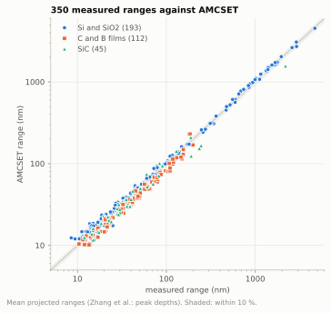
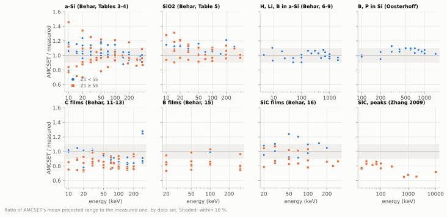
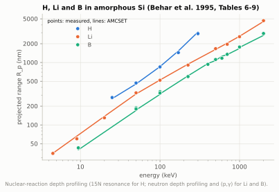
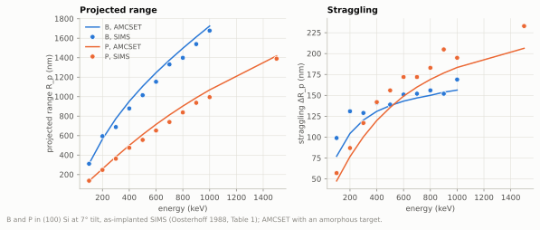
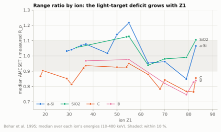
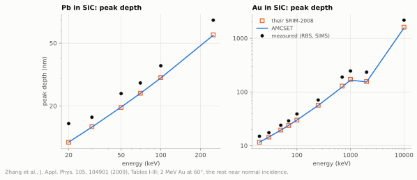
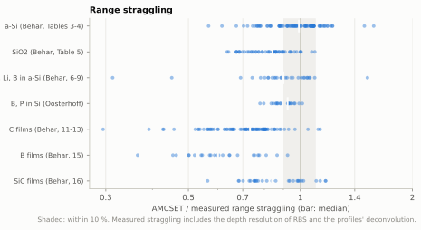

# 4. Ranges

[Review contents](README.md) · previous: [3. The Ni-ion problem](03-nickel.md) ·
next: [5. Sputtering](05-sputtering.md)

Where implanted ions come to rest is what most users of SRIM-type codes ask
for. This chapter compares AMCSET with 350 measured ranges from three
sources, covering ions from H to Bi at 4.5 keV to 10 MeV in Si, SiO2, C, B
and SiC, measured by Rutherford backscattering (RBS), secondary ion mass
spectrometry (SIMS) and nuclear reactions. A single SIMS case, 50 keV Sb in
Si, is added at the end.

## 4.1 The data

| Data set | Ions, energies | Targets | Method |
|---|---|---|---|
| Behar, Fichtner, Grande, Zawislak, Mater. Sci. Eng. R 15, 1 (1995), Tables 3-5 | Cu-Bi (11 ions) and As, Xe, Cs, Eu, Yb, Au, Bi, 10-400 keV | amorphous Si (amorphized by Ar beams); thermal SiO2 | RBS with 760 keV He, depth resolution down to 7 nm; errors ≤ 1.4 nm |
| Behar et al., Tables 6-9 | H 25-300 keV; Li 4.5 keV-2 MeV; ¹⁰B, ¹¹B 9.4 keV-2 MeV | amorphous Si | ¹⁵N resonance (H); neutron depth profiling and (p,γ) (Li, B) |
| Behar et al., Tables 11-13, 15, 16 | K-Bi 10-300 keV; F-Au 20-300 keV | C, B and SiC films 200-300 nm | RBS; F by a resonance |
| Oosterhoff, Nucl. Instrum. Methods B 30, 1 (1988), Table 1 | B 0.1-1 MeV, P 0.1-1.5 MeV | (100) Si at 7° tilt, about 27° twist | SIMS, as implanted |
| Zhang, Bae, Sun et al., J. Appl. Phys. 105, 104901 (2009), Tables I-III | Pb 20-250 keV; Au 20 keV-10 MeV | SiC | peak depths by RBS (Fichtner et al. 1992) and SIMS |

AMCSET: quick calculations with the bundled SRIM-2013 tables, 4000 ions ×
2 seeds per point (20 000 for peak depths), the papers' nominal densities,
amorphous targets. Oosterhoff's crystalline Si at 7° tilt and 27° twist is
modelled as amorphous: that orientation was chosen to avoid channeling. The
compared quantity is the mean projected range Rp and its straggling ΔRp; for
Zhang et al. it is the peak depth.

## 4.2 Overview

*Figure 4.1. AMCSET's range against the measured one, every point.*

Over three decades of depth the points follow the diagonal. The deviations
are systematic, not random: the points of C and B films (orange) and SiC
(aqua) lie below it, the Si and SiO2 points (blue) on it.

*Figure 4.2. AMCSET over measured, by data set, for ions lighter (blue) and
heavier (orange) than Z1 = 55.*

| Data set | Points | Median AMCSET / measured | Within 10 % | Straggling |
|---|---|---|---|---|
| a-Si, heavy ions (Behar 3-4) | 93 | 1.025 | 66 % | 0.992 |
| SiO2 (Behar 5) | 51 | 1.063 | 63 % | 0.842 |
| H, Li, B in a-Si (Behar 6-9) | 28 | 0.990 | 96 % | 0.912 |
| B, P in Si (Oosterhoff) | 21 | 1.055 | 95 % | 0.924 |
| C films (Behar 11-13) | 88 | 0.860 | 33 % | 0.735 |
| B films (Behar 15) | 24 | 0.851 | 33 % | 0.603 |
| SiC films (Behar 16) | 29 | 0.953 | 45 % | 0.839 |
| SiC peaks (Zhang 2009) | 16 | 0.802 | 0 % | — |

## 4.3 Silicon and SiO2: agreement

In Si and SiO2 the medians lie between 0.99 and 1.06, as Behar et al. found
for the ZBL stopping that SRIM inherits. Light ions are the best case.

*Figure 4.3. H, Li and B in amorphous Si: measured Rp (points) and AMCSET
(lines).*

H, Li and B follow the measurements from 4.5 keV to 2 MeV within 1-4 % per
ion (H 1.01, Li 1.02, B 0.96). Behar et al. note that B above 700 keV goes
6-10 % deeper than calculated; AMCSET's ¹⁰B ranges at 1 and 2 MeV are 4 and
7 % short.

*Figure 4.4. B and P in Si at 7° tilt (Oosterhoff 1988): range and
straggling.*

Oosterhoff's SIMS ranges of B and P are reproduced within 6-7 % on average
(AMCSET slightly deeper), and the straggling to 8 % on the median (AMCSET
narrower, by up to 22 %). Part of the range excess may be the SIMS depth
calibration; the crystal's residual channeling at 7° would widen the
measured profile, which matches AMCSET's narrower one.

For heavy ions in Si the spread is larger (Figure 4.2, top left): single
ions deviate by up to 22 %, Cs 22 % too deep in AMCSET and Au 14 % too
shallow.

*Figure 4.5. Median range ratio per ion, by target.*

This is the "Z1 oscillation" of low-energy heavy-ion ranges in Si. Behar et
al. remove it for Au, Yb and Eu below 70 keV with a cut-off interatomic
potential. Wittmaack (Nucl. Instrum. Methods B 388, 15 (2016)) re-analysed
four groups' data and found the deviations one-sided: implanted noble
metals and lanthanides move deeper during the bombardment, rare gases and
alkalis towards the surface. AMCSET's pattern fits that reading exactly: Au
measured deeper than calculated, Cs shallower. A binary-collision code does
not move implanted atoms after they stop, so it cannot follow either.

## 4.4 Heavy ions in light targets: too short

In C, B and SiC the heavy ions go deeper than calculated. For Pb, Bi, Au,
Yb and Er, AMCSET's ranges are 12-25 % short of the measured ones, and the
straggling 16-40 % smaller. Ions closer to the target's mass agree: Cs, Xe,
Rb and Kr in C, Cs and Rb in B, and F, Ga and Cs in SiC lie within 2-11 %.
Figure 4.5 shows the deficit growing with the ion's Z1 in C and B.

*Figure 4.6. Peak depths of Pb and Au in SiC: measured, Zhang et al.'s
SRIM-2008, and AMCSET.*

AMCSET reproduces Zhang et al.'s SRIM-2008 peaks to 1 % up to 250 keV and
2-4 % at 0.7-10 MeV, and both lie 13-35 % short of the measurements. The
literature offers two explanations, and neither is in AMCSET:

- Behar et al.: in close collisions of a heavy ion with a light atom, the
  electronic energy loss and the nuclear scattering are correlated, which
  lowers the effective nuclear stopping. Their modified TRIM with one
  parameter (α = 0.5) reproduces C, B, Be, SiC and photoresist.
- Zhang et al.: SRIM's electronic stopping of slow heavy ions in light
  compounds is about twice too high (their reciprocity estimate is 25-47 %
  of SRIM's). Weber and Zhang (2019) reproduce the measured Au profile in
  SiC with SRIM by lowering the density to 2.78 g/cm³.

## 4.5 Straggling

*Figure 4.7. AMCSET's range straggling over the measured one, by data set.*

The straggling agrees in amorphous Si (median 0.99). Elsewhere AMCSET's
profiles are narrower: 8-16 % in SiO2 and for the light ions, 16-40 % in the
light targets. Measured widths include the depth resolution of the method
and any broadening by the implantation itself, so a narrower calculation is
expected; the light-target deficit is larger than that.

## 4.6 One SIMS case: 50 keV Sb in Si

Titze et al. (J. Vac. Sci. Technol. A 39, 063222 (2021)) implanted Sb into Si
with a 2.9 nm native oxide at 7° and measured a mean depth of 27.5 ± 1.3 nm
by SIMS. Their SRIM-2013 run gives 32.8 nm; AMCSET with the same target gives
33.53 ± 0.16 nm (straggling 9.76 nm against 9.7 nm measured): SRIM's result
and 22 % deeper than measured. The paper finds SRIM 2-6 nm too deep from 10
to 150 keV and attributes it to SRIM's low-energy stopping of heavy ions
(only 5 Sb data points in SRIM). Like Cs and the other heavy ions of §4.3,
it belongs to the low-energy heavy-ion regime where SRIM's ranges are off by
±10-25 % ion by ion.

## 4.7 Summary

| Regime | AMCSET (= SRIM-2013) | Use |
|---|---|---|
| Light ions (H-P) in Si, 5 keV-2 MeV | within 1-7 % | as is |
| Heavy ions in Si and SiO2, 10-400 keV | median within 2-6 %, single ions ±10-22 % | as is; expect ion-specific errors |
| Heavy ions (Z1 > 55) in C, B, SiC, 10 keV-10 MeV | 12-25 % too short, straggling too narrow | add the deficit, or calibrate against a measurement |
| Ni ions, 1-17 MeV | 1.2-1.9 × too deep | `nickel_ions` (Chapter 3) |
