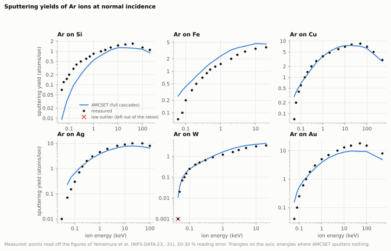
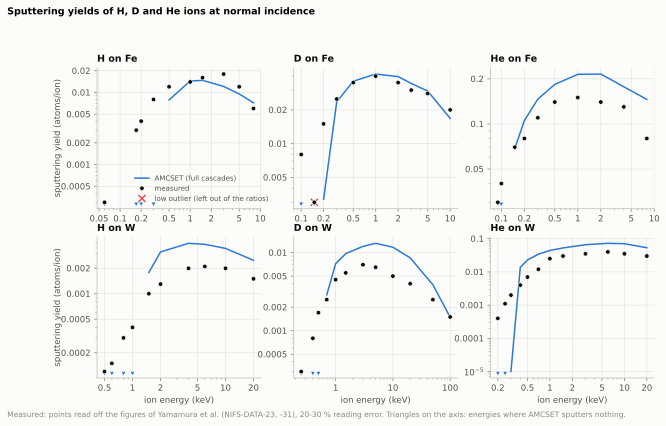
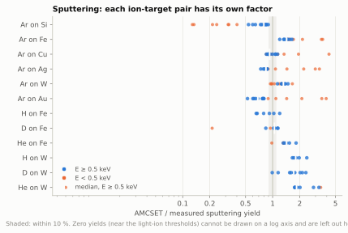

# 5. Sputtering

[Review contents](README.md) · previous: [4. Ranges](04-ranges.md) ·
next: [6. Damage](06-damage.md)

Sputtering, the ejection of surface atoms by the cascade, is set by the
energy deposited in the first few atomic layers and by the surface binding
energy Es that an atom must overcome. TRIM computes it in full-cascade mode
from the recoils that reach the surface with enough energy. AMCSET reproduces
TRIM's sputtering yields: 36 sputtering cases agree within the statistics
(Chapter 1). This chapter compares them with measurements.

## 5.1 The data and the calculation

Yamamura and Tawara compiled every measured sputtering yield at normal
incidence for monatomic solids: NIFS-DATA-23 (1995; At. Data Nucl. Data
Tables 62, 149 (1996)) for heavy ions, and Yamamura, Sakaoka and Tawara,
NIFS-DATA-31 (1996), for H, D, T and He. Their tables of data are graphs;
the values used here were read off the graphs of Ar on Si, Fe, Cu, Ag, W and
Au (96 points) and of H, D and He on Fe and W (64 points). Only measured
points were read, not the authors' fitted curves. The reading precision on
their log-log plots is about 20-30 %, worse near the threshold. Where
data sets disagree the main cluster was read; two points far below the
others (Ar on W at 45 eV, D on Fe at 150 eV) are drawn but left out of the
ratios.

AMCSET: full cascades, TRIM's default Ed, Eb (3 eV) and Es (the heat of
sublimation, e.g. Fe 4.34, W 8.68, Au 3.80 eV), the target depth sized
automatically, and enough ions for about 2000 sputtered atoms per point (at
most 200 000).

## 5.2 Argon

*Figure 5.1. Sputtering yields of Ar ions: measured (black) and AMCSET
(blue).*

The shape of every curve is right: the rise from threshold, the maximum near
10-50 keV, the fall at higher energies where the ion deposits its energy
deeper. The level is not. Cu (0.94 above 0.5 keV) and Ag (0.85) agree within
the reading precision. Fe (1.45) and W (1.32) are too high at every energy,
while Au (0.68, falling to 0.53 at 50 keV) and Si (0.80) are too low. Near the
threshold the differences grow: Ar on Si at 50-200 eV is 3-8 × low, and Ar
on Fe, Cu and Ag near 50-100 eV 2-4 × high.

## 5.3 Hydrogen and helium

*Figure 5.2. Sputtering yields of H, D and He ions on Fe and W. Triangles on
the axis: energies where AMCSET sputters no atom.*

For light ions the threshold matters most. Their yields are small (10⁻⁴ to
0.2 atoms per ion) and come from a few recoils, mostly ones turned around in
the target. Near the threshold AMCSET, like TRIM, sputters nothing where
small yields were measured: H on W at and below 1 keV, D on W at and below
0.5 keV, He on W below 0.3 keV, H on Fe below 0.5 keV. TRIM's cascade ends at Ed and Eb,
and its planar surface barrier needs more energy than real surfaces do. The
threshold energies derived from these data are lower than TRIM's model
allows.

Above the threshold the yields on Fe agree for H and D (0.92 and 1.05) and
are too high for He (1.43); on W all three are too high by 1.7-1.9 ×. The W
excess, with W's high Es (8.68 eV), suggests that TRIM's surface model
works least well for W.

## 5.4 Each pair has its factor

*Figure 5.3. AMCSET over measured for every pair: points at and above
0.5 keV (blue), below (orange), and the median above 0.5 keV (bar).*

| Ion on target | Median, E ≥ 0.5 keV | Range, E ≥ 0.5 keV |
|---|---|---|
| Ar on Si | 0.80 | 0.54-0.89 |
| Ar on Fe | 1.45 | 1.20-1.64 |
| Ar on Cu | 0.94 | 0.85-1.14 |
| Ar on Ag | 0.85 | 0.74-0.88 |
| Ar on W | 1.32 | 1.13-1.48 |
| Ar on Au | 0.68 | 0.53-0.80 |
| H on Fe | 0.92 | 0.66-1.20 |
| D on Fe | 1.05 | 0.84-1.15 |
| He on Fe | 1.43 | 1.31-1.82 |
| H on W | 1.72 | 0-2.40 |
| D on W | 1.72 | 0-2.34 |
| He on W | 1.88 | 1.76-3.27 |

Over all 98 points above 0.5 keV the median is 1.05 and 88 % lie within a
factor of 2. That median hides the structure: each pair has its own factor
(0.68 to 1.88), steady over one to three decades of energy. This is the
pattern of a model whose cascade physics is right and whose surface is not:
the energy at the surface scales correctly with ion and energy, and the
fraction of it that ejects atoms is set by one number per target, the surface
binding energy.

## 5.5 What to use

- AMCSET's sputtering yields are TRIM's. They are right within a factor of
  about 1.5 for heavy ions on most metals above 0.5 keV, and within a factor
  of 2 for light ions on W.
- Near the threshold (below a few hundred eV for Ar, below 1-2 keV for
  hydrogen on W) TRIM's model gives no yield or far too little.
- The usual way to adjust TRIM's yields to a measurement is the surface
  binding energy, `layers[].elements[].Es`. A measured yield at one energy
  fixes it for that pair; the factor then holds over a wide energy range.
- Not covered: the angular dependence of sputtering, energy distributions of
  sputtered atoms, compounds and preferential sputtering, and measured
  reflection coefficients (none were found in open sources).
