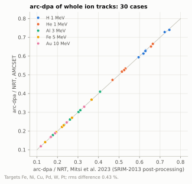
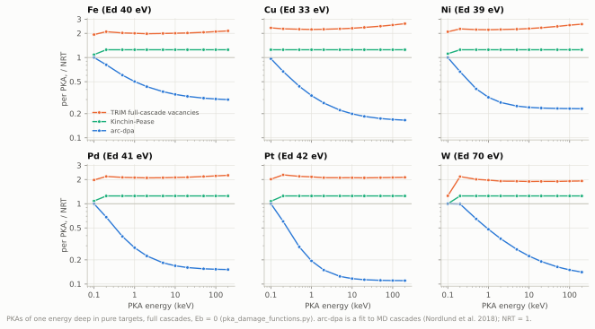

# 6. Damage

[Review contents](README.md) · previous: [5. Sputtering](05-sputtering.md) ·
next: [7. Crystals](07-crystals.md)

"How much damage" has several answers, and a code that reports a number
should say which one it is. TRIM counts vacancies, in two ways: the quick
calculation applies the Kinchin-Pease model to each primary recoil, and the
full-cascade calculation follows every recoil above the displacement energy
Ed. The NRT standard (Norgett, Robinson and Torrens 1975; ASTM E521)
converts damage energy into displacements, 0.8·T_dam / (2 Ed). And molecular
dynamics (MD) shows that most displaced atoms recombine within picoseconds;
the arc-dpa and rpa damage functions of Nordlund et al. (Nature Commun. 9,
1084 (2018)) are fits to it. AMCSET reports all of them per depth
(`dpa` table, `docs/OUTPUT.md`). This chapter tests the implementation, then
asks which describes the damage best.

## 6.1 The implementation against published SRIM post-processing

Mitsi, Koutsomitis and Apostolopoulos (Nucl. Instrum. Methods B, 2023;
arXiv 2307.12867) applied arc-dpa to every primary recoil in the collision
files of SRIM-2013 quick calculations: H, He, Al, Fe and Au ions into Fe,
Ni, Cu, Pd, W and Pt, 30 cases.

*Figure 6.1. arc-dpa / NRT of whole ion tracks, AMCSET against Mitsi et al.,
with their Ed per target.*

AMCSET's quick calculation gives their ratio in all 30 cases to 0.43 % rms
(largest −0.92 %, for 1 MeV H into Pd, whose reference has three digits and
AMCSET's a standard error of 2 %). Per ion, 78.7 keV Fe into Fe gives NRT
529.5 and arc-dpa 216.6 against their 530 and 217. The damage energy, the
partition into primary recoils and the damage functions are therefore those
of SRIM post-processing. Chapter 1 (§1.5) shows the same for Stoller et
al.'s and Weber and Zhang's published vacancies.

## 6.2 Damage functions per recoil

To see the models apart, primary recoils (PKAs) of one energy were started
deep inside pure targets in random directions, with full cascades, Eb = 0 and
the Ed of the arc-dpa fits (`tools/damage_models/pka_damage_functions.py`).

*Figure 6.2. Per PKA, relative to NRT: TRIM's full-cascade vacancies,
Kinchin-Pease and arc-dpa, 0.1-200 keV.*

Three regimes:

- **TRIM's full-cascade vacancies are about 2-2.5 × NRT** at every energy
  above a few hundred eV (Fe 1.93-2.15, Cu 2.24-2.64, W 1.9-2.2). A full
  cascade counts every atom moved above Ed; NRT's 0.8/(2 Ed) was calibrated
  to binary-collision results with a different threshold model. This is why
  Stoller et al. (2013) advise against full-cascade vacancies as a dose.
- **Kinchin-Pease is 1.25 × NRT** above 2.5 Ed, by definition.
- **arc-dpa falls from 1 to 0.11-0.35 × NRT** between the threshold and
  about 10 keV, then levels off: the fraction of Frenkel pairs that survive
  recombination in MD. The level depends on the metal (Fe 0.30, Ni 0.23,
  Cu 0.17, Pt 0.11 at 100 keV).

So, against MD, TRIM's full-cascade vacancies overestimate the surviving
defects by 4× (Fe and W at 1 keV) to 19× (Pt at 100 keV), and NRT by 2-9×.
TRIM's replacements are 21-275 × fewer than the replaced atoms of MD (rpa):
a binary-collision cascade has no heat spike, which is where most mixing
happens.

## 6.3 Against experiments

Averback, Benedek and Merkle (Phys. Rev. B 18, 4156 (1978)) measured the
resistivity of Cu and Ag foils irradiated at 6 K, where defects do not
move. Relative to a modified Kinchin-Pease function they found an efficiency
of about 1 for protons, falling with the ion's mass to about 0.35 (Cu) and
0.4 (Ag) for ions heavier than Ne. Nordlund et al. (2018) summarise the
experimental and MD data for Cu as about 1/3 of NRT for energetic cascades.
AMCSET's arc/NRT in Cu is 0.63 for 1 MeV H, 0.53 for 1 MeV He and 0.19-0.26
for 3-10 MeV Al, Fe and Au; per PKA 0.20 at 10 keV and 0.17 at 100 keV. The
paper itself was not available; these are efficiencies, not the same runs.

## 6.4 Which number to report

| Question | Use | Why |
|---|---|---|
| Dose, to compare irradiations or with neutron dpa | NRT (`nrt`, = TRIM's quick-calculation vacancies) | the standard (ASTM E521); Stoller et al. 2013 |
| How many defects survive the cascade (primary damage), in metals | arc-dpa (`arc_dpa`) | fitted to MD; closest to the 6 K experiments in Cu, though 25-45 % below them |
| How many atoms change place (mixing) | rpa (`rpa`) | TRIM's replacements are not a measure of it |
| Where atoms are displaced | TRIM's full-cascade vacancy profile, normalised | its shape, not its magnitude |

None of these includes thermally activated recombination, clustering or the
overlap of cascades at high dose. For W, a newer MD study (Byggmästar et al.,
arXiv 2503.02710 (2025)) finds a superlinear regime above about 20-30 keV
and a linear one above 300 keV that arc-dpa does not follow, so arc-dpa may
underestimate the primary damage of the most energetic recoils in W.
