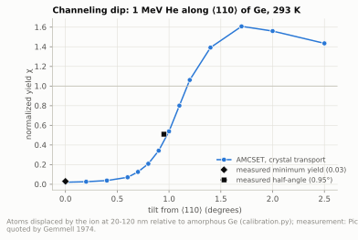
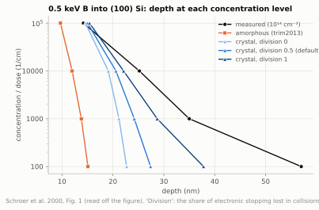
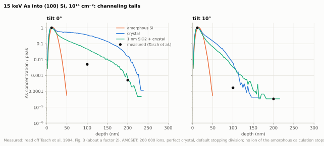

# 7. Crystals

[Review contents](README.md) · previous: [6. Damage](06-damage.md) ·
next: [8. Ionization by slow recoils](08-ionization.md)

TRIM treats every target as amorphous. AMCSET's crystal transport
(`physics.transport: crystal`) follows ions through a lattice, after Robinson
and Torrens (1974): collision partners are found on lattice sites displaced
by thermal vibrations, so ions can channel along rows and planes. This
transport is AMCSET's own, not TRIM's, and only measurements can test it.
Its one free parameter is the division of the electronic stopping between a
part lost along the path and a part lost in the collisions
(`physics.crystal.local_stopping_fraction`, default 0.5); it decides how far
channeled ions get. The checks without measurements (a random direction
gives the amorphous result, symmetry, normalisation) are in `docs/CLI.md`
"The crystal transport".

## 7.1 A channeling dip

The textbook test: the yield of close-encounter events against the tilt
from a crystal axis. Along the axis, ions are steered away from the rows
and the yield drops to a minimum; a degree off it, the yield is back at
the random level, with a shoulder above it.

*Figure 7.1. 1 MeV He along ⟨110⟩ of Ge at 293 K: atoms displaced by the ion
at 20-120 nm, relative to amorphous Ge, against the tilt.*

AMCSET's minimum yield is 0.021 and its half-angle 0.99° (0.80 ψ₁), against
the measured 0.03 and 0.95° (Picraux et al., as quoted by Gemmell 1974) and
Barrett's formulas, 0.025 and 0.93°. The shoulder reaches 1.56-1.61 at
1.7-2.0°. The thermal vibration amplitudes come from Debye temperatures and
reproduce Gemmell's tabulated values for all 19 elements of his Table IV.

## 7.2 Boron in silicon

Boron is the classic channeling dopant: light, fast, and implanted into
(100) Si at a few degrees off the axis. Three as-implanted SIMS
measurements were compared, for five divisions of the stopping
(`tools/crystal/calibration.py`; `docs/VALIDATION.md` §6 has the full
table). The moments of 15 keV B at 7° (Jung 2010) come within 2-3 % in Rp
and 2-9 % in ΔRp for every division, where the amorphous calculation misses
the width by 19 %. The 30 keV profile of Shao et al. (2003) is reproduced
down to 10¹⁸ cm⁻³ within the reading of the figure. The most demanding case
is 0.5 keV B at normal incidence:

*Figure 7.2. 0.5 keV B into (100) Si (Schroer et al. 2000): the depth at
which the concentration falls through each level. Measured (black),
amorphous (orange), crystal transport with three divisions (blue, light to
dark).*

The amorphous calculation misses the profile from the first decade on
(9.7 nm where 14.2 nm was measured). The crystal transport gets the first
decade right (14.6-15.4 nm) and the second 12-24 % short (19.1-22.1 nm
against 25.2 nm). In the deep tail
(10³ and 10² per cm), the division matters: 0 gives the shortest tails, 1
the longest (37.8 nm), and none reaches the measured 57 nm. The data bracket
the division between 0.25 (the 30 keV tail) and 1 (the 0.5 keV tail and the
15 keV skewness); the default 0.5 is not a fit.

## 7.3 Arsenic channeling tails against tilt

Tasch, Yang, Morris and Lim (J. Vac. Sci. Technol. B 12, 166 (1994))
implanted 15 keV As into (100) Si at 10¹⁴ cm⁻² and tilts from 0 to 10°, and
into amorphous Si, with SIMS profiles. Their wafers had about 1 nm of native
oxide; the beam divergence and the wafer miscut were each below 0.5°. The
values were read off their Fig. 3 (log scale, about a factor 2).

*Figure 7.3. 15 keV As in Si at 0° and 10° tilt: AMCSET's profiles relative
to their peak, for amorphous Si (orange), the crystal (blue) and the crystal
under 1 nm of SiO2 (aqua), and the measured peak and concentrations at 100
and 200 nm (black).*

| Case | c(100 nm)/peak | Measured | c(200 nm)/peak | Measured |
|---|---|---|---|---|
| crystal, 0° | 0.35 | 5·10⁻³ | 1.8·10⁻² | 5·10⁻⁴ |
| crystal with 1 nm oxide, 0° | 4.5·10⁻² | 5·10⁻³ | 7.2·10⁻⁴ | 5·10⁻⁴ |
| crystal, 10° | 6.0·10⁻³ | 1.7·10⁻⁴ | 0 | 3.3·10⁻⁵ |
| crystal with 1 nm oxide, 10° | 3.4·10⁻³ | 1.7·10⁻⁴ | 4.8·10⁻⁶ | 3.3·10⁻⁵ |

The peak (12-16 nm) and the fall of the tails with tilt are reproduced, and
the native oxide turns out to matter: one nanometre of amorphous oxide
scatters the slow As ions out of the ⟨100⟩ channel and lowers the 0° tail at
100 nm eightfold. With the oxide, the 0° tail at 200 nm agrees (1.4 × the
measured one). Still, at 100 nm the tails are 9 × (0°) and 20 × (10°) the
measured ones, and at 10° the calculated tail ends before 200 nm, where
3·10⁻⁵ of the peak was measured. AMCSET channels too many ions to about
100 nm and dechannels the deeper ones too abruptly.

What the model leaves out, in order of likely importance:

- **Damage by the earlier ions.** 10¹⁴ cm⁻² of As is near the dose that
  amorphizes Si, and Tasch et al. see the tails shrink as the dose rises.
  AMCSET's crystal is perfect for every ion.
- **Beam divergence and wafer miscut** (below 0.5° each), which smear the
  incidence angle.
- **The stopping division**, which the boron data leave open.

The boron profiles were measured at doses that leave the lattice largely
intact, and they agree. The As case shows the limit of a perfect crystal for
slow heavy ions. Both point to dose-dependent dechanneling (phase 5 of
`docs/CRYSTAL_DESIGN.md`) as the next step.

## 7.4 What to use

- For light ions (B) at low dose, the crystal transport reproduces measured
  profiles where the amorphous calculation cannot; the deep tails depend on
  the stopping division (0.25-1).
- For heavy ions at doses near amorphization, the channeling tails are an
  upper estimate. Add the native oxide as an amorphous top layer: it is
  real, and it matters for slow ions.
- Ranges in a crystal exceed amorphous ones through channeling, also at the
  usual 7° tilt (`docs/CLI.md` "Why ranges in a crystal are longer").
