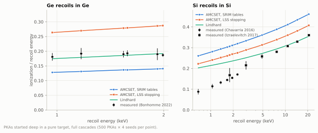

# 8. Ionization by slow recoils

[Review contents](README.md) · previous: [7. Crystals](07-crystals.md) ·
next: [9. Conclusions](09-conclusions.md)

When a recoil of a few keV slows down, part of its energy ends as ionization
and the rest as atomic motion. The ionization share, the "quenching factor"
of particle detectors, is measured down to sub-keV recoils in Ge and Si for
dark-matter and neutrino experiments. It tests the electronic stopping of
slow atoms and the energy partition of the whole cascade, which in TRIM is
the ionization by the ion plus the ionization by all recoils.

## 8.1 The data and the calculation

| Target | Measurement | Energies |
|---|---|---|
| Ge | Bonhomme et al., Eur. Phys. J. C 82, 815 (2022), Table 5; compatible with Lindhard k = 0.162 | 0.97-1.99 keV |
| Si | Chavarria et al., Phys. Rev. D 94, 082007 (2016), Table 1 | 0.68-2.28 keV |
| Si | Izraelevitch et al., JINST 12, P06014 (2017), Table 1 | 1.79-20.7 keV |

AMCSET: 500 PKAs of each energy started deep inside the pure target in
random directions, full cascades, TRIM's default energies, 4 seeds; the
ionization share is the sum of the ionization by the PKAs and by their
recoils. Once with SRIM-2013's tables and once with the Lindhard-Scharff
(LSS) stopping (`--stopping lss`). For reference, Lindhard's theory:
k·g/(1 + k·g), with g = 3ε^0.15 + 0.7ε^0.6 + ε and ε = 11.5·E[keV]·Z^(−7/3).

## 8.2 Results

*Figure 8.1. Ionization yield of Ge recoils in Ge (left) and Si recoils in
Si (right): measured (black), AMCSET with SRIM's tables (blue) and with LSS
stopping (orange), and Lindhard's theory (aqua).*

**Ge**: AMCSET gives 0.128-0.141, 25-32 % below the measured 0.181-0.193.
With LSS stopping it gives 0.264-0.287, 41-53 % above. Lindhard's formula
(0.175-0.192) agrees with the data, as Bonhomme et al. found.

**Si**: AMCSET gives 0.261-0.462, above all measurements: 28 % at 20 keV, 3 ×
at 0.7 keV. LSS stopping lowers it by 12-15 % but stays far above, and
Lindhard's formula is also high below a few keV. The Si data fall more
steeply towards low energies than any of the three.

## 8.3 Why no stopping model fixes it

The two targets go opposite ways with the same model: SRIM's tables give
too little ionization in Ge and too much in Si. A change of the electronic
stopping moves both the same way. The discrepancy therefore lies in the
energy partition of a binary-collision cascade at these energies, not in
the stopping alone. A binary-collision cascade has no collective effects
(heat spike, the binding of the lattice, the electronic excitation in close
collisions that Chapter 4 met for heavy ions in light targets), and these
matter most for sub-keV recoils. For detector work, measured yields (or
Lindhard's formula with a fitted k) should be used. AMCSET's ionization
tallies are SRIM's and are reported as they are.
