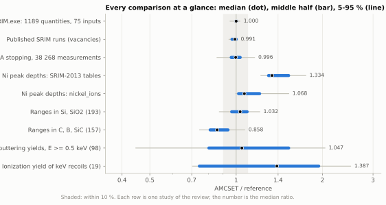

# Validating AMCSET: a review

How well does AMCSET reproduce what ions do in matter? This review compares
its results with every independent reference it was tested against: SRIM-2013's
TRIM.exe, published SRIM calculations, measured stopping powers, measured
ranges, sputtering yields, damage models fitted to molecular dynamics,
channeling measurements, and the ionization of slow recoils. Each chapter
explains a comparison with figures, says what agrees and what does not, and
why.

`docs/VALIDATION.md` is the reference behind it: the tables, parameters and
the exact numbers of every case. This review is the explanation of them, and
the figures are drawn from the same output files.



*Figure 0. One row per study: the median ratio of AMCSET's result to the
reference (dot), the middle half of the ratios (bar) and 5-95 % of them
(line). The top four rows test the code; the lower rows test SRIM-2013's
physics, which AMCSET reproduces.*

## In short

1. **AMCSET reproduces TRIM.exe.** In 1031 of 1032 comparisons of integral
   quantities with 161 TRIM.exe runs, the difference lies within three
   standard errors. Its depth profiles match bin by bin, and published SRIM
   damage calculations agree to 0-7 %. [Chapter 1](01-trim.md).
2. **The stopping tables are SRIM-2013's, and SRIM-2013 fits most
   measurements.** Against 38 268 measurements of the IAEA database the
   median ratio is 0.996, and 81 % lie within 10 %. For protons and alpha
   particles the tables follow NIST within 3 % above 0.1 MeV/u.
   [Chapter 2](02-stopping.md).
3. **One ion is out of line: nickel.** SRIM-2013's Ni stopping is up to
   39 % below that of its neighbours Co and Cu, and measured Ni ranges are
   1.2-1.9 × shorter than SRIM's. AMCSET's optional correction
   (`physics.stopping_corrections.nickel_ions`) reproduces six of ten
   measured peak depths within 9 %. [Chapter 3](03-nickel.md).
4. **Ranges agree in Si; heavy ions in light targets go 12-25 % deeper than
   calculated**, as the literature reports for SRIM. [Chapter 4](04-ranges.md).
5. **Sputtering yields** agree on the median, but each ion-target pair has
   its own factor, 0.68-1.9. [Chapter 5](05-sputtering.md).
6. **Damage**: AMCSET's arc-dpa reproduces published SRIM post-processing to
   0.43 %. TRIM's full-cascade vacancies count 2-2.5 times NRT, which is
   4-19 times the defects that survive in MD. [Chapter 6](06-damage.md).
7. **The crystal transport** reproduces a channeling dip and boron profiles,
   but overestimates the channeling tails of slow heavy ions at doses near
   amorphization. [Chapter 7](07-crystals.md).
8. **Ionization of keV recoils** is off by 25-30 % in Ge and by up to 3 × in
   Si, with SRIM's tables as with Lindhard's stopping.
   [Chapter 8](08-ionization.md).

What it all means for users, the switches that correct known deviations,
and what is left open: [Chapter 9](09-conclusions.md).

## Contents

| Chapter | Subject | Figures |
|---|---|---|
| [1. AMCSET against TRIM.exe](01-trim.md) | the statistical comparison with 161 TRIM runs; Ni-ion runs; published SRIM calculations | 4 |
| [2. Electronic stopping](02-stopping.md) | the SRIM-2013 tables against their own Z1 trend, the IAEA database and NIST | 10 |
| [3. The Ni-ion problem](03-nickel.md) | measured Ni peak depths, the correction, sputtering during implantation | 4 |
| [4. Ranges](04-ranges.md) | 350 measured ranges in Si, SiO2, C, B and SiC; light ions; peaks in SiC | 7 |
| [5. Sputtering](05-sputtering.md) | yields of Ar, H, D and He on six elements | 3 |
| [6. Damage](06-damage.md) | NRT, Kinchin-Pease, arc-dpa, TRIM's vacancies; MD and SRIM post-processing | 2 |
| [7. Crystals](07-crystals.md) | channeling dip, boron profiles, As channeling tails | 3 |
| [8. Ionization by slow recoils](08-ionization.md) | the ionization yield of keV Ge and Si recoils | 1 |
| [9. Conclusions](09-conclusions.md) | deviations, corrections, recommendations, open questions | — |

## How the comparisons are made

**AMCSET's SRIM mode** (the default engine) follows TRIM.exe step by step,
with SRIM-2013's electronic stopping tables for every ion in every element
(`data/srim2013`). Unless a chapter says otherwise, every calculation here
uses that mode, TRIM's default displacement, lattice and surface binding
energies (or the paper's, where it states them), and amorphous targets. A
statement about SRIM-2013's physics is therefore a statement about AMCSET's,
and the other way round.

**Ratios.** Most figures show AMCSET's value divided by the reference. The
grey band marks ±10 % unless the caption says otherwise; on log axes the band
looks asymmetric. A ratio above 1 means AMCSET's value is larger (a range
longer, a stopping power higher).

**Statistics.** AMCSET's results are averages over several seeds (four as a
rule), and the standard errors are given where they matter. For the
comparison with TRIM.exe, differences are expressed as z, the difference in
standard errors of both codes' scatter (Chapter 1). Most measurements carry
uncertainties of a few per cent to tens of per cent. Where a value was read
off a published figure rather than a table, the chapter says so and gives
the reading precision.

**Sources.** Every measured value, its source and its conditions are written
into the scripts next to the scenario that reproduces it
(`tools/validation/literature_cases.py`, `range_data.py`, `sputter_data.py`).
The IAEA database and NIST's tables are downloads that are not in the
repository; `docs/VALIDATION.md` says where to get them.

## Reproducing the review

The scripts use Python's standard library and the `amcset` executable; the
figures need matplotlib. On Windows, after
`build\Release\generators\conanrun.bat`:

```bat
python tools\validation\literature_cases.py --exe build\Release\amcset.exe --out build\validation\literature
python tools\validation\stopping_reference.py --exe build\Release\amcset.exe --iaea StoppingPower.csv --nist DIR --out build\validation\stopping
python tools\validation\srim_table_scan.py --exe build\Release\amcset.exe --out build\validation\table_scan --threshold 0.15
tools\windows\compare_with_trim.bat
python tools\validation\make_figures.py
```

The TRIM comparison takes about an hour and the literature cases about half
an hour; the other scripts take minutes. `make_figures.py` redraws every
figure of this review into `docs/validation/figures/` from their output, and
skips a figure whose input is missing. The damage-model and crystal figures
also read the output of `tools/damage_models/` and
`tools/crystal/calibration.py` (see `docs/VALIDATION.md` §5, §6).
